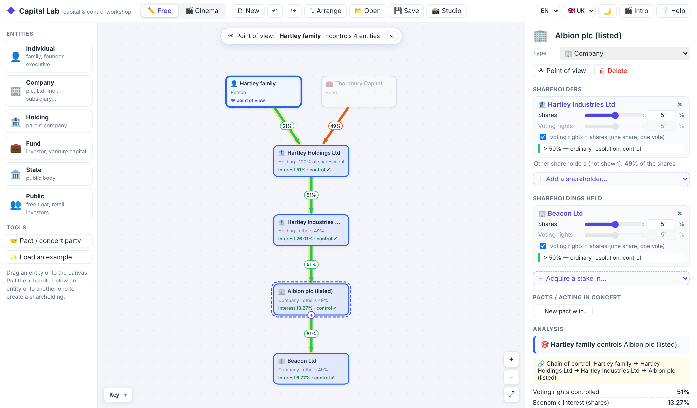
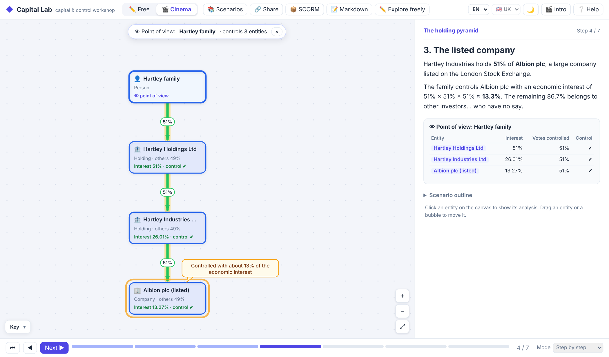
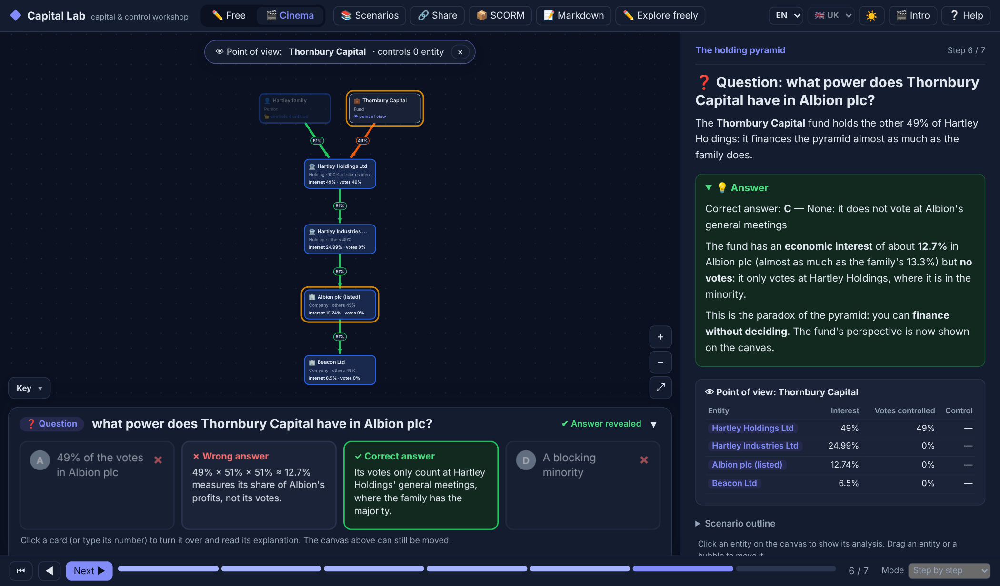
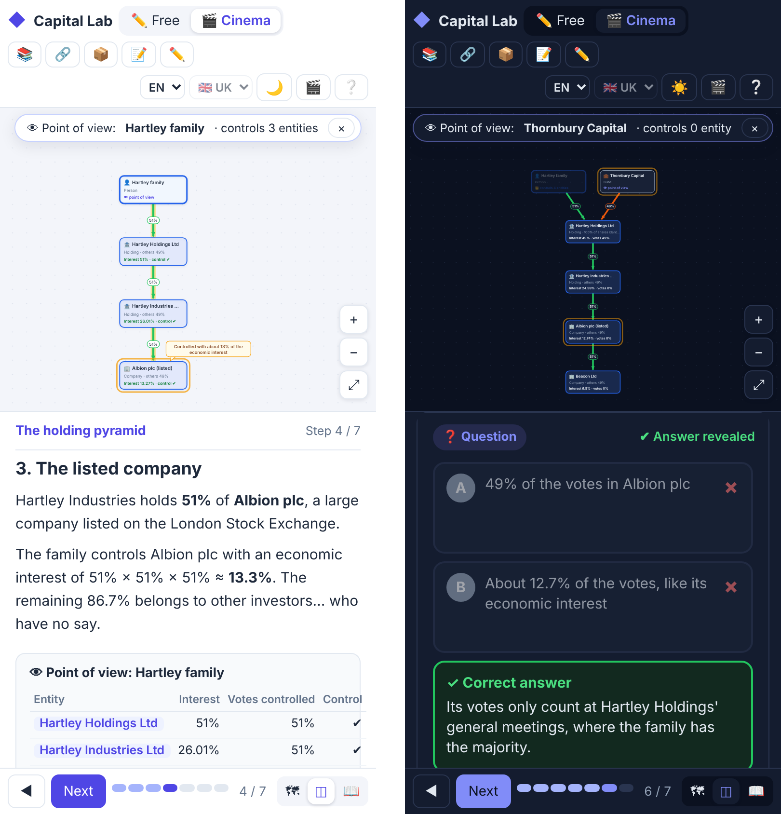
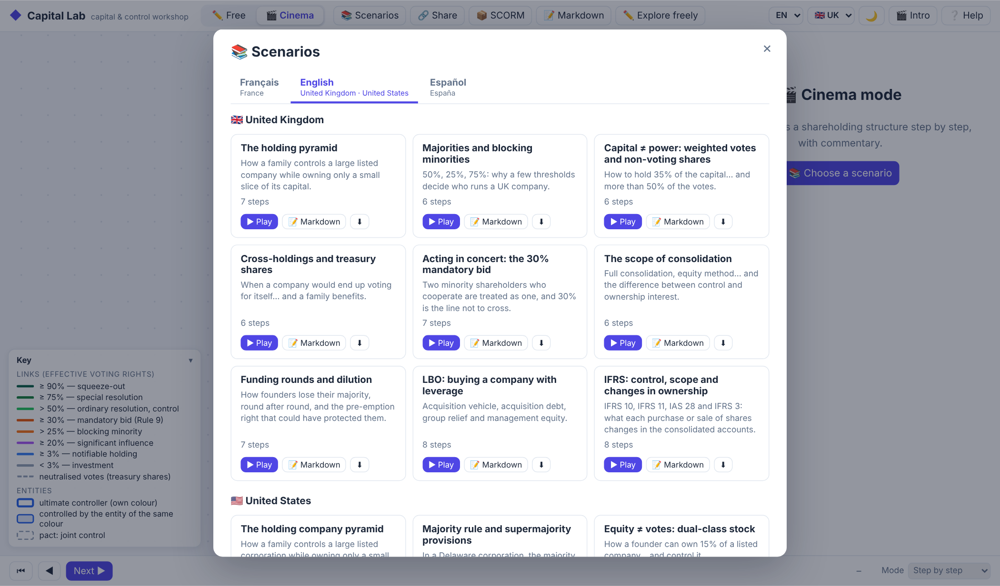
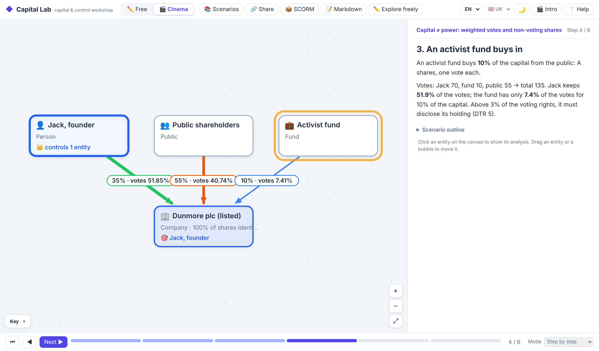
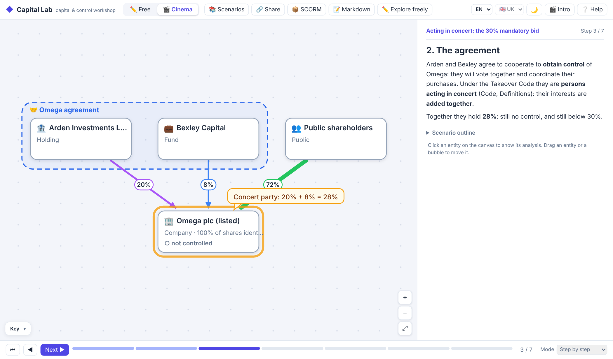
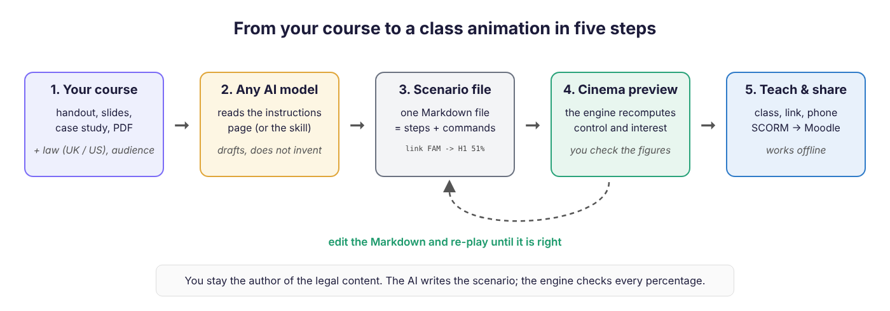
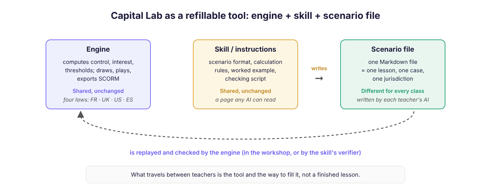

# Capital Lab — shareholding & control workshop

[](https://doi.org/10.5281/zenodo.24464409)
Source code: [github.com/edu-fpar/capital-lab](https://github.com/edu-fpar/capital-lab)

[Français](README.md) · **English** · 🇪🇸 [Español](README.es.md)

[](https://edu-fpar.github.io/capital-lab/en/)

A teaching tool to visualise and explain shareholding structures between companies:
you can be a **minority** shareholder in a company and still **control** it, through chains of holdings,
shareholder agreements, multiple voting rights, treasury shares…

**▶ Online: [edu-fpar.github.io/capital-lab/en](https://edu-fpar.github.io/capital-lab/en/)** (works on phones too) ·
🎬 [video tour](https://edu-fpar.github.io/capital-lab/intro.html?lang=en) ·
[documentation](https://edu-fpar.github.io/capital-lab/docs/#/en/)

**Two laws in English**: **UK law** (Companies Act 2006, Takeover Code) or **US law** (Delaware, federal securities law), chosen in the toolbar. Thresholds, legend, analysis texts and the built-in scenarios follow the chosen law. The interface is also available in French (French law) and Spanish (Spanish law): language selector in the toolbar, or `?lang=en` / `?lang=es`.

No installation: open `index.html` (double-click) or serve the folder with any local web server.
No external dependency, works offline.

## Two modes

- **✏️ Free**: drag entities from the palette onto the canvas, draw holdings from the `+` handle,
  capital / voting-rights sliders, automatic analysis (ultimate controller, chain of control,
  economic interest, blocking minority, treasury shares), a shareholder's point of view, shareholder agreements.
  The **📸 Studio** captures annotated steps and exports them as a markdown scenario.
- **🎬 Cinema**: plays a markdown scenario, **step by step** or in **continuous play**
  (adjustable pace), with **questions for the class** and a phone-friendly view.
  Direct link: `?lang=en&scenario=uk-pyramid&etape=5`, `?scenarios`, or the 🔗 Share button.
  The **📦 SCORM** button exports the scenario as a package for Moodle or another LMS (completion, resume, score).





<p align="center"></p>

## Built-in scenarios

Adapted to each country's law (not mere translations):

- UK law (`js/library-uk.js`): `uk-pyramid`, `uk-majorities`, `uk-voting-rights`, `uk-treasury-shares`, `uk-concert`, `uk-consolidation`, `uk-dilution`, `uk-lbo`, `uk-ifrs`;
- US law (`js/library-us.js`): `us-pyramid`, `us-majority`, `us-dual-class`, `us-treasury-stock`, `us-group`, `us-consolidation`, `us-dilution`, `us-lbo`.

A scenario states its law in a header: `---` / `droit: uk` / `---`.



| Weighted votes (UK) | Acting in concert (UK) |
|---|---|
|  |  |

## Writing a scenario (teacher or AI)

The full format is in the app (❔ Help → “Scenario format”), with a **🤖 Prompt for an AI** button
that holds the specification, ready to paste into an assistant along with your course.



```markdown
# My scenario
> Short description.

## 1. First step
Commentary in **markdown**.

```scene
person FAM "Harrison family"
holding H1 "Harrison Holdings Ltd"
link FAM -> H1 51%
highlight H1
```
```

## Documentation and AI skill

- Full documentation: [edu-fpar.github.io/capital-lab/docs/#/en/](https://edu-fpar.github.io/capital-lab/docs/#/en/) (sources in `docs/en/`).
- Claude skill to generate a scenario from course material: `skill/scenario-capital-lab.skill` (see `docs/en/ia-et-skill.md`).



## Acknowledgements

Thanks to **Tao**, whose tool, designed to show a financial-law class how you can control a company while being a minority shareholder, started this project, and to **Yannick**, who passed the idea on to us.

## License and citation

© 2026 François Parlant — [CC BY-NC-SA 4.0](https://creativecommons.org/licenses/by-nc-sa/4.0/). Using it in class or in training is free, with credit to the author; adaptations must be shared under the same license. See [LICENSE](LICENSE).

**Commercial use** (training company, publisher, white label, custom scenarios, tailored SCORM packages): a commercial license is available by agreement. [Get in touch](https://edu-fpar.github.io/about.html?lang=en).

**How to cite** (GitHub's *Cite this repository* button, from [CITATION.cff](CITATION.cff)):

> Parlant, F. (2026). *Capital Lab* [Educational software]. Zenodo. https://doi.org/10.5281/zenodo.24464409

Using it in class? [Let me know](https://www.linkedin.com/in/francois-parlant/): this feedback helps me improve the tool and spread the word.
