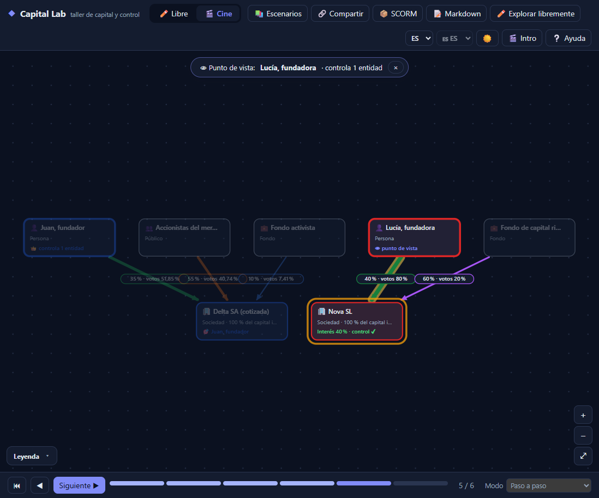

# Capital Lab — taller de capital y poder

[](https://doi.org/10.5281/zenodo.24464409)
Código fuente: [github.com/edu-fpar/capital-lab](https://github.com/edu-fpar/capital-lab)

[Français](README.md) · 🇬🇧 [English](README.en.md) · **Español**

[](https://edu-fpar.github.io/capital-lab/es/)

Herramienta didáctica para visualizar y explicar las estructuras de participaciones entre sociedades:
se puede ser **minoritario** en una sociedad y, sin embargo, **controlarla** mediante cadenas de participaciones,
pactos parasociales, acciones con voto plural, autocartera…

**▶ En línea: [edu-fpar.github.io/capital-lab/es](https://edu-fpar.github.io/capital-lab/es/)** (también en el móvil) ·
🎬 [visita guiada en vídeo](https://edu-fpar.github.io/capital-lab/intro.html?lang=es) ·
[documentación](https://edu-fpar.github.io/capital-lab/docs/#/es/)

**Derecho español** (Ley de Sociedades de Capital, OPA, NIIF): los umbrales, la leyenda, los textos de análisis y los escenarios integrados lo siguen. La interfaz también existe en francés (derecho francés) y en inglés (derecho británico o estadounidense): selector de idioma en la barra de herramientas, o `?lang=es` / `?lang=en`.

Sin instalación: abra `index.html` (doble clic) o sirva la carpeta con cualquier servidor web local.
Sin dependencias externas, funciona sin conexión.

## Dos modos

- **✏️ Libre**: paleta de entidades que se arrastran al lienzo, participaciones trazadas desde el tirador `+`,
  cursores de capital / derechos de voto, análisis automático (controlador último, cadena de control,
  interés económico, minoría de bloqueo, autocartera), punto de vista de un accionista, pactos.
  El **📸 Estudio** captura pasos comentados y los exporta como escenario markdown.
- **🎬 Cine**: reproduce un escenario markdown, **paso a paso** o en **reproducción continua**
  (ritmo ajustable), con **preguntas a la clase** y una vista adaptada al móvil.
  Enlace directo: `?lang=es&scenario=es-piramide&etape=5`, `?scenarios`, o el botón 🔗 Compartir.
  El botón **📦 SCORM** exporta el escenario como paquete para Moodle u otra plataforma (finalización, reanudación, nota).

## Escenarios integrados

Adaptados al derecho español, no simples traducciones (`js/library-es.js`):
`es-piramide`, `es-mayorias`, `es-derechos-voto`, `es-autocartera`, `es-concierto`, `es-consolidacion`, `es-dilucion`, `es-lbo`, `es-niif`.

Un escenario indica su derecho en un encabezado: `---` / `droit: es` / `---`.

## Escribir un escenario (docente o IA)

El formato completo está en la aplicación (❔ Ayuda → «Formato de los escenarios»), con un botón
**🤖 Instrucción para una IA** que contiene la especificación, lista para pegar en un asistente junto con su curso.

```markdown
# Mi escenario
> Descripción breve.

## 1. Primer paso
Comentario en **markdown**.

```scene
persona FAM "Familia García"
holding H1 "García Participaciones"
vinculo FAM -> H1 51%
resaltar H1
```
```

## Documentación y skill de IA

- Documentación completa: [edu-fpar.github.io/capital-lab/docs/#/es/](https://edu-fpar.github.io/capital-lab/docs/#/es/) (fuentes en `docs/es/`).
- Skill de Claude para generar un escenario a partir de un material de curso: `skill/scenario-capital-lab.skill` (véase `docs/es/ia-et-skill.md`).

## Agradecimientos

Gracias a **Tao**, cuya herramienta, ideada para mostrar a su clase de derecho financiero cómo se puede controlar una sociedad siendo minoritario, está en el origen de este proyecto, y a **Yannick**, que nos transmitió la idea.

## Licencia y cita

© 2026 François Parlant — [CC BY-NC-SA 4.0](https://creativecommons.org/licenses/by-nc-sa/4.0/deed.es). El uso en clase y en formación es libre, citando al autor; sus adaptaciones se comparten con la misma licencia. Véase [LICENSE](LICENSE).

**Uso comercial** (centro de formación, editorial, marca blanca, escenarios a medida, paquetes SCORM personalizados): es posible una licencia comercial previo acuerdo. [Contactar](https://edu-fpar.github.io/about.html?lang=en).

**Cómo citar** (botón *Cite this repository* de GitHub, a partir de [CITATION.cff](CITATION.cff)):

> Parlant, F. (2026). *Capital Lab* [Software educativo]. Zenodo. https://doi.org/10.5281/zenodo.24464409

¿Lo usa en clase? [Cuéntemelo](https://www.linkedin.com/in/francois-parlant/): estos comentarios me ayudan a mejorar la herramienta y a darla a conocer.
