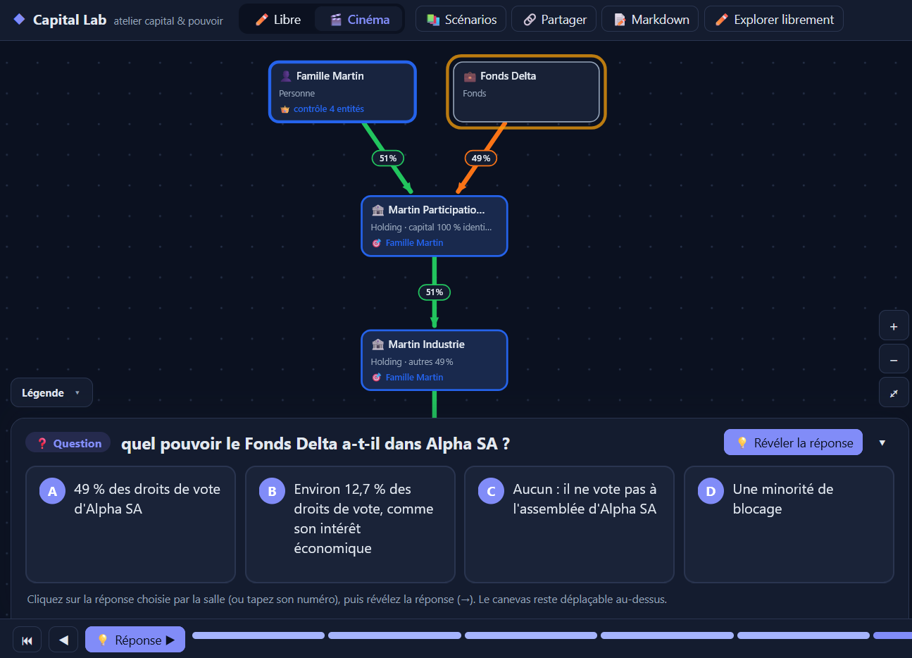

# Capital Lab — atelier capital & pouvoir

[](https://doi.org/10.5281/zenodo.24464409)

[](https://edu-fpar.github.io/capital-lab/)

Outil pédagogique pour visualiser et expliquer les structures de participations entre sociétés :
on peut être **minoritaire** dans une société et pourtant la **contrôler** via des chaînes de participations,
des pactes, des droits de vote double, l'autocontrôle…

**▶ En ligne : [edu-fpar.github.io/capital-lab](https://edu-fpar.github.io/capital-lab/)** (aussi sur téléphone) ·
[documentation](https://edu-fpar.github.io/capital-lab/docs/)

**Trois langues, quatre droits** : français (droit français), anglais (droit britannique ou américain, au choix dans la barre d'outils) et espagnol (droit espagnol). Langue : sélecteur dans la barre d'outils ou `?lang=en` / `?lang=es`. Les seuils, la légende, les textes d'analyse et les scénarios suivent le droit choisi. 🇬🇧 [English below](#english) · 🇪🇸 [Español más abajo](#español)

Aucune installation : ouvrez `index.html` (double-clic) ou servez le dossier avec UwAmp
(`http://localhost/edu-fpar/capital-lab/`). Pas de dépendance externe, fonctionne hors ligne.

## Deux modes

- **✏️ Libre** : palette d'entités à glisser sur le canevas, liens tirés depuis la poignée `+`,
  curseurs capital / droits de vote, analyse automatique (contrôleur ultime, chaîne de contrôle,
  intérêt économique, minorité de blocage, autocontrôle), point de vue d'un actionnaire, pactes.
  Le **📸 Studio** capture des étapes commentées et les exporte en scénario markdown.
- **🎬 Cinéma** : déroule un scénario markdown, en **pas à pas** ou en **lecture continue**
  (rythme réglable), avec des **questions à la salle** et une vue adaptée au téléphone.
  Lien direct : `?scenario=pyramide&etape=6`, `?scenarios`, ou le bouton 🔗 Partager.
  Le bouton **📦 SCORM** exporte le scénario en paquet pour Moodle ou un autre LMS (achèvement, reprise, note).

  

## Scénarios intégrés

`pyramide`, `majorites`, `droits-de-vote`, `autocontrole`, `concert`, `controle-de-fait`,
`consolidation`, `dilution`, `lbo`, `ifrs` — dans `js/library.js`.

Versions étrangères, adaptées au droit de chaque pays (pas de simples traductions ; le contrôle de fait à 40 %, propre au droit français, n'y figure pas) :

- droit britannique, en anglais (`js/library-uk.js`) : `uk-pyramid`, `uk-majorities`, `uk-voting-rights`, `uk-treasury-shares`, `uk-concert`, `uk-consolidation`, `uk-dilution`, `uk-lbo`, `uk-ifrs` ;
- droit américain, en anglais (`js/library-us.js`) : `us-pyramid`, `us-majority`, `us-dual-class`, `us-treasury-stock`, `us-group`, `us-consolidation`, `us-dilution`, `us-lbo` ;
- droit espagnol, en espagnol (`js/library-es.js`) : `es-piramide`, `es-mayorias`, `es-derechos-voto`, `es-autocartera`, `es-concierto`, `es-consolidacion`, `es-dilucion`, `es-lbo`, `es-niif`.

Un scénario indique son droit par un en-tête `---` / `droit: uk` / `---`.

## Écrire un scénario (enseignant ou IA)

Le format complet est dans l'application (❔ Aide → « Format des scénarios »), avec un bouton
**🤖 Copier le prompt pour une IA** qui contient la spécification prête à coller dans un assistant.

```markdown
# Mon scénario
> Description courte.

## 1. Première étape
Commentaire en **markdown**.

```scene
personne FAM "Famille Martin"
holding H1 "Martin Participations"
lien FAM -> H1 51%
focus H1
```
```

## Documentation et skill IA

- Documentation complète : `docs/index.html` (Docsify, à ouvrir via un serveur web, comme UwAmp). Les pages sont aussi lisibles directement : ce sont les fichiers `docs/*.md`.
- Skill Claude pour générer un scénario à partir d'un support de cours : `skill/scenario-capital-lab.skill` (voir `docs/ia-et-skill.md`).
- Après une modification du moteur, du format ou des scénarios : `node tools/build.js`, puis `python tools/package_skill.py`.

## Fichiers

| Fichier | Rôle |
|---|---|
| `js/model.js` | moteur : contrôle en chaîne, autocontrôle, concert, contrôle de fait, intérêts, disposition auto ; seuils et références de chaque droit (`P.JURIS` : fr, uk, us, es) |
| `js/i18n.js`, `js/i18n-en.js`, `js/i18n-es.js` | langue de l'interface (`P.t`) et dictionnaires ; `node tools/i18n-check.js` signale les chaînes non traduites |
| `js/docs-en.js`, `js/docs-es.js`, `docs/en/`, `docs/es/` | aide intégrée, format, consigne IA et documentation en anglais et en espagnol |
| `docs/i18n-spec.md` | cadrage des langues, des droits et des seuils |
| `js/scenario.js` | parseur markdown → étapes, commandes, export studio, rendu markdown |
| `js/app.js` | interface : canevas SVG, inspecteur, lecteur cinéma, studio |
| `js/library.js` | scénarios intégrés |
| `js/docs.js` | aide, spécification du format, prompt IA |
| `js/scorm.js`, `js/scorm-runtime.js` | export SCORM et dialogue avec la plateforme dans le paquet |
| `intro.html`, `intro/kit/` | visite guidée en vidéo (FR/EN/ES, 16:9 · 9:16 · 1:1), faite avec anim-kit ; `?dev=1` montre les formats et les coulisses, `intro/kit/planche.html?src=../../intro.html` la planche contact |
| `js/intro-launcher.js` | bouton 🎬 Intro et ouverture automatique de la vidéo à la première visite (`?intro=0` pour l'éviter) |

## Remerciements

Merci à **Tao**, dont l'outil imaginé pour montrer à sa classe de droit financier comment on peut contrôler une société tout en y étant minoritaire est à l'origine de ce projet, et à **Yannick**, qui nous a transmis cette idée.

## Licence et citation

© 2026 François Parlant — [CC BY-NC-SA 4.0](https://creativecommons.org/licenses/by-nc-sa/4.0/deed.fr). L'usage en classe et en formation est libre, en citant l'auteur ; vos adaptations se partagent sous la même licence. Voir [LICENSE](LICENSE).

**Usage commercial** (organisme de formation, éditeur, marque blanche, scénarios sur mesure, paquets SCORM personnalisés) : une licence commerciale est possible sur accord. [Me contacter](https://edu-fpar.github.io/about.html).

**Citer cet outil** (bouton *Cite this repository* de GitHub, d'après [CITATION.cff](CITATION.cff)) :

> Parlant, F. (2026). *Capital Lab* [Logiciel pédagogique]. Zenodo. https://doi.org/10.5281/zenodo.24464409

Vous l'utilisez en cours ? [Dites-le-moi](https://www.linkedin.com/in/francois-parlant/) : ces retours m'aident à faire connaître et améliorer l'outil.

### License and citation

© 2026 François Parlant — [CC BY-NC-SA 4.0](https://creativecommons.org/licenses/by-nc-sa/4.0/). Using it in class or in training is free, with credit to the author; adaptations must be shared under the same license. See [LICENSE](LICENSE).

**Commercial use** (training company, publisher, white label, custom scenarios, tailored SCORM packages): a commercial license is available by agreement. [Get in touch](https://edu-fpar.github.io/about.html?lang=en).

**How to cite** (GitHub's *Cite this repository* button, from [CITATION.cff](CITATION.cff)):

> Parlant, F. (2026). *Capital Lab* [Educational software]. Zenodo. https://doi.org/10.5281/zenodo.24464409

Using it in class? [Let me know](https://www.linkedin.com/in/francois-parlant/): this feedback helps me improve the tool and spread the word.

## English

Capital Lab is also available **in English**, under **UK law** (Companies Act 2006, Takeover Code) or **US law** (Delaware, federal securities law): choose the law in the toolbar. Thresholds, legend, analysis and the built-in scenarios follow the chosen law. Open [edu-fpar.github.io/capital-lab/?lang=en](https://edu-fpar.github.io/capital-lab/?lang=en) · [documentation](https://edu-fpar.github.io/capital-lab/docs/#/en/) · [video tour](https://edu-fpar.github.io/capital-lab/intro.html?lang=en).

## Español

Capital Lab también está disponible **en español**, con el **derecho español** (Ley de Sociedades de Capital, OPA, NIIF). Abrir [edu-fpar.github.io/capital-lab/?lang=es](https://edu-fpar.github.io/capital-lab/?lang=es) · [documentación](https://edu-fpar.github.io/capital-lab/docs/#/es/) · [visita guiada](https://edu-fpar.github.io/capital-lab/intro.html?lang=es).
