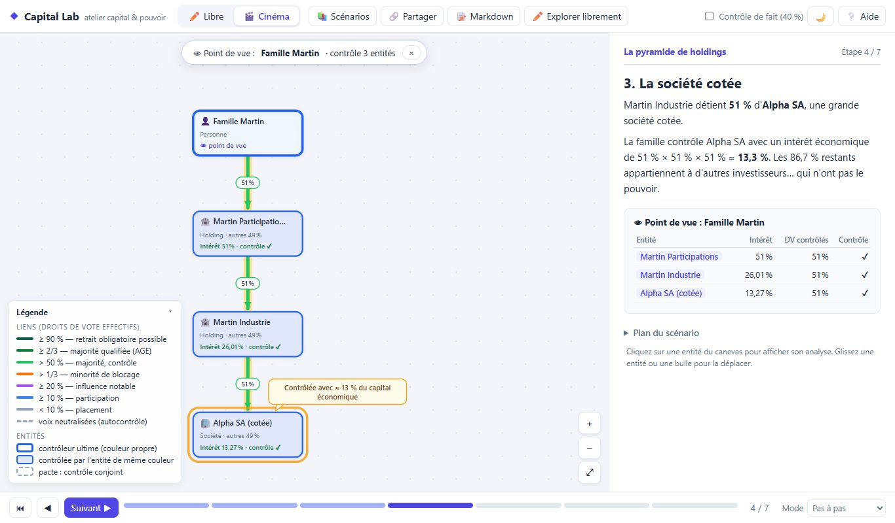

# Capital Lab — atelier capital & pouvoir

**Capital Lab** est un outil pédagogique pour visualiser les structures de détention entre sociétés et comprendre **qui contrôle quoi, par quelle chaîne, et avec quelle part réelle du capital**.

Il montre notamment comment on peut être **minoritaire en capital** et pourtant **contrôler** une société : pyramides de holdings, pactes d'actionnaires, droits de vote double, autocontrôle, contrôle de fait…

[▶ Ouvrir l'atelier](../index.html ':ignore') — en ligne : **https://edu-fpar.github.io/capital-lab/**, utilisable aussi sur téléphone.

Le mode libre (nuit) : une coentreprise sous pacte, le point de vue de Mère SA sur chaque entité, et à droite les curseurs et l'analyse de la filiale sélectionnée.

## 🤖 Préparer son cours avec une IA

<ol class="ai-steps">
<li><strong>Copiez la consigne.</strong> Elle contient déjà le lien vers les instructions pour l'IA. Le texte est modifiable : adaptez le public ou le nombre d'étapes avant de copier.

Lis les instructions sur https://edu-fpar.github.io/capital-lab/docs/instructions-ia.md et prépare un scénario Capital Lab à partir du cours ci-dessous (ou du fichier joint). Public : L3 droit des affaires, 6 étapes environ, avec une ou deux questions pour la salle.

<button class="ai-btn big" data-copy-sel=".js-ia-prompt">📋 Copier la consigne</button></li>
<li><strong>Collez-la dans votre IA</strong> (ChatGPT, Claude, Gemini, Mistral, Copilot…), puis ajoutez votre cours : texte collé à la suite, ou fichier joint.</li>
<li><strong>Copiez la réponse de l'IA</strong> et collez-la dans l'<a href="../index.html?scenarios" target="_blank" rel="noopener">atelier</a> : 🎬 Cinéma → 📚 Scénarios → Lancer. Vous pouvez coller la réponse entière.</li>
</ol>

Votre IA ne peut pas ouvrir de lien ?

Copiez à la place la version complète : les instructions et la consigne réunies en un seul texte. Collez-le dans votre IA, puis ajoutez votre cours.

<button class="ai-btn warn" data-copy-full="instructions-ia.md">📄 Copier la version complète</button> <a class="ai-link" href="instructions-ia.md" target="_blank" rel="noopener">voir les instructions</a>

💡 Vous utilisez Claude ? La <a href="#/ia-et-skill">skill Capital Lab</a> vérifie en plus chaque chiffre avec le moteur de l'atelier.

ℹ️ Vous consultez cette documentation en local : la consigne pointe vers la version publiée, qu'une IA en ligne peut lire.

## Deux façons d'utiliser l'atelier

| | Mode libre ✏️ | Mode cinéma 🎬 |
|---|---|---|
| Pour qui | l'enseignant qui prépare, l'étudiant qui expérimente | la classe, pendant le cours ; l'étudiant qui révise sur téléphone |
| Principe | on construit la structure à la souris et on règle les pourcentages avec des curseurs | un scénario markdown déroule la construction étape par étape, avec un commentaire et des questions à la salle |
| Rythme | libre | pas à pas, ou lecture continue à vitesse réglable |

Les deux modes partagent le même moteur de calcul : contrôle en chaîne, intérêt économique, seuils, autocontrôle, pactes.

Le mode cinéma (jour) : la pyramide de holdings, étape 3. Le commentaire est à droite ; chaque entité affiche l'intérêt et le contrôle de la famille Martin.

## Par où commencer ?

- **Découvrir** : ouvrez l'atelier, passez en mode 🎬 Cinéma et lancez « La pyramide de holdings ».
- **Présenter en classe** : [Mode cinéma](mode-cinema.md), [scénarios disponibles](scenarios.md) et [liens de partage](mode-cinema.md#partager-un-lien).
- **Construire sa propre structure** : [Prise en main du mode libre](prise-en-main.md).
- **Écrire un scénario** : avec une IA (ci-dessus, ou la [skill](ia-et-skill.md)), ou à la main avec le [format des scénarios](format-scenario.md).
- **Comprendre un résultat surprenant** : [Règles de calcul](regles-de-calcul.md).

## Installation

Aucune. L'atelier est un ensemble de fichiers HTML, CSS et JavaScript sans dépendance :
- en ligne sur **https://edu-fpar.github.io/capital-lab/** ;
- servi par un serveur web local (UwAmp, par exemple : `http://localhost/edu-fpar/capital-lab/`) ;
- ou ouvert directement en double-cliquant sur `index.html`.

Le bouton 🌙 / ☀️ en haut à droite bascule entre mode jour et mode nuit, ici comme dans l'atelier.

Cette documentation a besoin d'un serveur web et d'une connexion internet (elle utilise [Docsify](https://docsify.js.org)). Sans cela, ses pages restent lisibles telles quelles : ce sont les fichiers `.md` du dossier `docs/`.

## Remerciements

Merci à **Tao**, dont l'outil imaginé pour montrer à sa classe de droit financier comment on peut contrôler une société tout en y étant minoritaire est à l'origine de ce projet, et à **Yannick**, qui nous a transmis cette idée.
