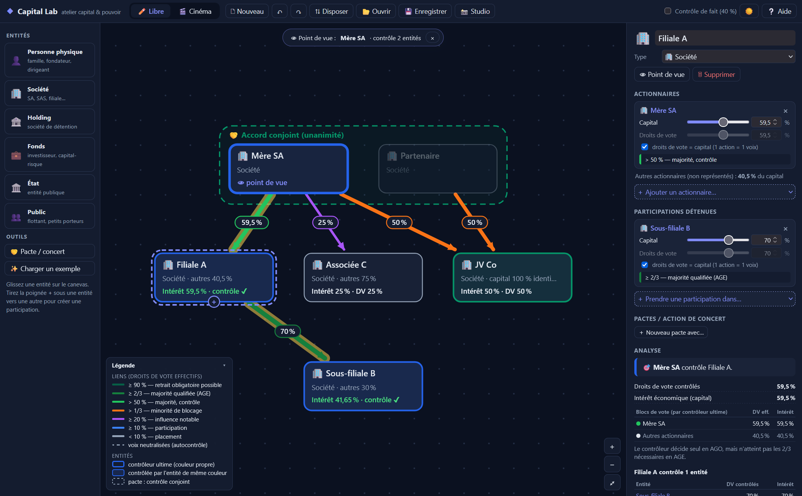
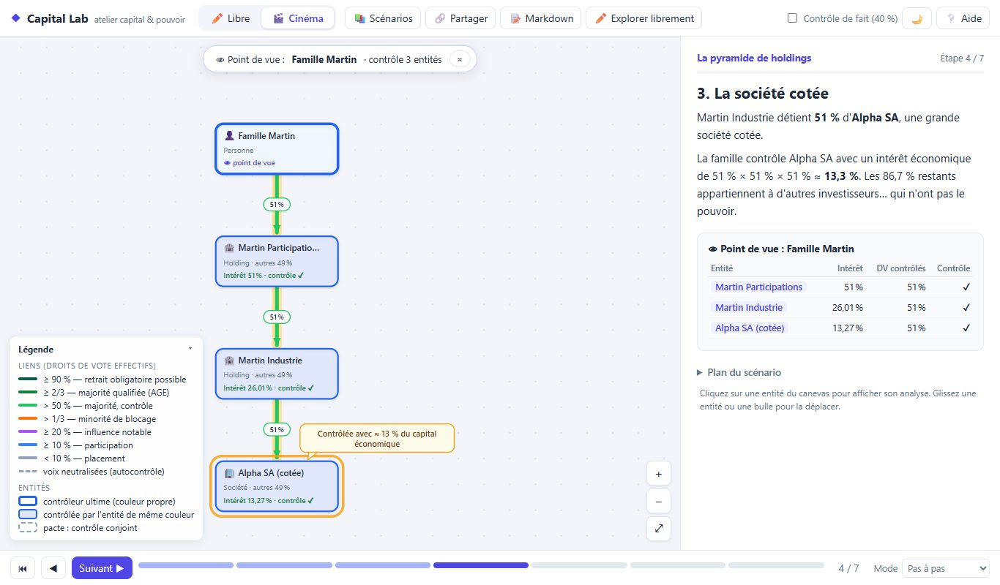

# Capital Lab — shareholding & control workshop

**Capital Lab** is a teaching tool for visualising shareholding structures between companies and understanding **who controls what, through which chain, and with what real share of the capital**.

In particular, it shows how a shareholder can hold a **minority of the capital** and still **control** a company: pyramids of holding companies, shareholders' agreements and concert parties, dual-class shares, treasury shares and cross-holdings…

[▶ Open the workshop](../index.html?lang=en ':ignore') — online at **https://edu-fpar.github.io/capital-lab/?lang=en**, also usable on a phone.

> 🌐 This documentation also exists in [French](../README.md) and [Spanish](../es/README.md).

Free mode (night theme): a joint venture under a pact, the parent company's point of view on every entity, and on the right the sliders and the analysis of the selected subsidiary. Screenshots show the French interface.

## Two laws: United Kingdom and United States

In English, the workshop offers two legal systems, chosen with the selector in the toolbar (a scenario can also impose its own law):

| | United Kingdom `uk` | United States `us` |
|---|---|---|
| Sources | Companies Act 2006, Takeover Code, Disclosure Guidance and Transparency Rules | Delaware General Corporation Law (DGCL), Securities Exchange Act of 1934 |
| Key thresholds | 3%, 25%, 30%, 50%, 75%, 90% | 5%, 10%, 15%, 50%, 90% |
| Specific features | blocking minority above 25%, mandatory offer at 30% | interested stockholder at 15%, no statutory blocking minority |

The law changes the **thresholds, colours, legend and legal references** of the analysis. **Control** is computed in the same way everywhere: more than 50% of the effective voting rights, passed down the chain. See [Calculation rules](regles-de-calcul.md).

By default, the workshop uses US law if your browser is set to American English, and UK law otherwise.

## 🤖 Prepare your lesson with an AI

<ol class="ai-steps">
<li><strong>Copy the request.</strong> It already contains the link to the instructions for the AI. The text can be edited: adjust the law (UK or US), the audience or the number of steps before copying.

Read the instructions at https://edu-fpar.github.io/capital-lab/docs/en/instructions-ia.md and prepare a Capital Lab scenario (UK law) from the course below (or the attached file). Audience: undergraduate company law students, about 6 steps, with one or two questions for the class.

<button class="ai-btn big" data-copy-sel=".js-ia-prompt">📋 Copy the request</button></li>
<li><strong>Paste it into your AI</strong> (ChatGPT, Claude, Gemini, Mistral, Copilot…), then add your course material: text pasted after it, or an attached file.</li>
<li><strong>Copy the AI's answer</strong> and paste it into the <a href="../index.html?lang=en&scenarios" target="_blank" rel="noopener">workshop</a>: 🎬 Cinema → 📚 Scenarios → Play. You can paste the whole answer.</li>
</ol>

Your AI cannot open links?

Copy the full version instead: the instructions and the request combined in a single text. Paste it into your AI, then add your course material.

<button class="ai-btn warn" data-copy-full="en/instructions-ia.md">📄 Copy the full version</button> <a class="ai-link" href="instructions-ia.md" target="_blank" rel="noopener">see the instructions</a>

💡 Using Claude? The <a href="#/en/ia-et-skill">Capital Lab skill</a> also checks every figure with the workshop's engine.

## Two ways to use the workshop

| | Free mode ✏️ | Cinema mode 🎬 |
|---|---|---|
| For whom | the teacher preparing a lesson, the student experimenting | the class, during the lesson; the student revising on a phone |
| Principle | build the structure with the mouse and set the percentages with sliders | a markdown scenario builds the structure step by step, with a commentary and questions for the class |
| Pace | free | step by step, or continuous play at an adjustable speed |

Both modes share the same calculation engine: chained control, economic interest, thresholds, treasury shares, concert parties.

Cinema mode (day theme): the holding pyramid, step 3. The commentary is on the right; every entity shows the family's interest and control.

## Where to start?

- **Discover**: open the workshop, switch to 🎬 Cinema mode and play "The holding pyramid".
- **Teach in class**: [Cinema mode](mode-cinema.md), [available scenarios](scenarios.md) and [share links](mode-cinema.md#share-a-link).
- **Build your own structure**: [Getting started with free mode](prise-en-main.md).
- **Write a scenario**: with an AI (above, or the [skill](ia-et-skill.md)), or by hand with the [scenario format](format-scenario.md).
- **Understand a surprising result**: [Calculation rules](regles-de-calcul.md).

## Installation

None. The workshop is a set of HTML, CSS and JavaScript files with no dependencies:
- online at **https://edu-fpar.github.io/capital-lab/** (add `?lang=en` for English);
- served by a local web server (UwAmp, for instance: `http://localhost/edu-fpar/capital-lab/`);
- or opened directly by double-clicking `index.html`.

The 🌙 / ☀️ button at the top right switches between day and night themes, here as in the workshop.

This documentation needs a web server and an internet connection (it uses [Docsify](https://docsify.js.org)). Without them, its pages remain readable as they are: they are the `.md` files of the `docs/en/` folder.

## Acknowledgements

Thanks to **Tao**, whose tool, designed to show a financial law class how one can control a company while being a minority shareholder, gave rise to this project, and to **Yannick**, who passed the idea on to us.
