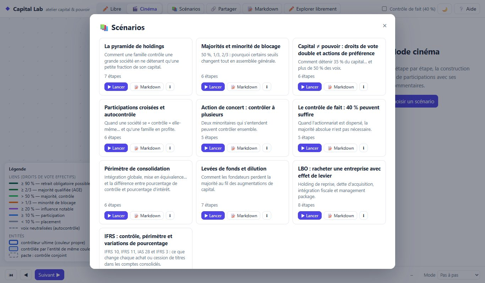
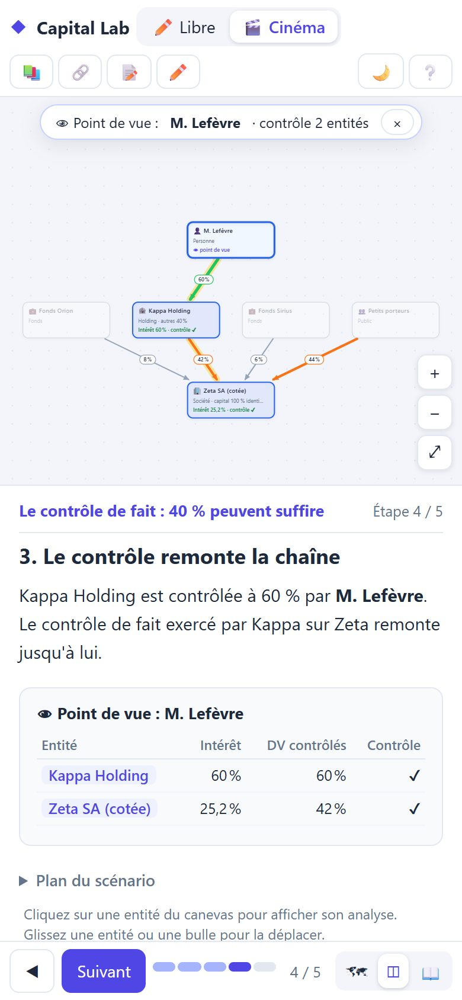
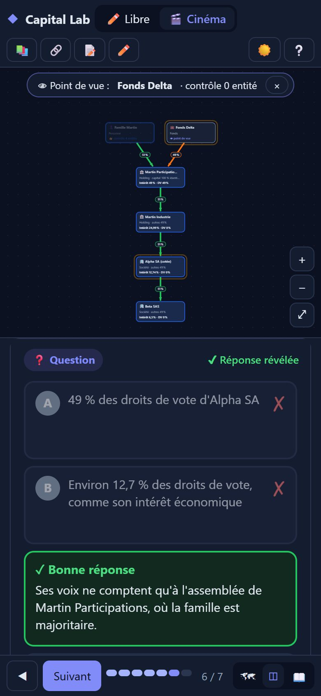
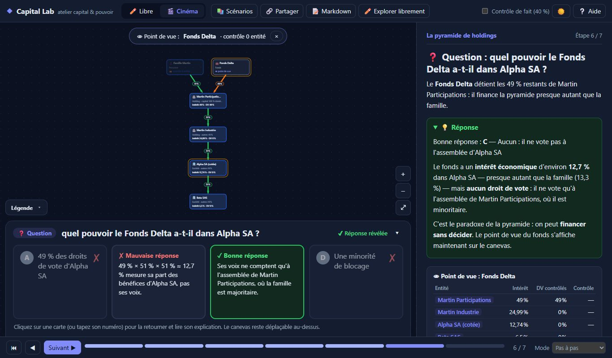

# Cinema mode

Cinema mode 🎬 plays a **scenario**: at each step, the canvas comes to life (entities appearing, links being drawn, bubbles and highlights) and the right-hand panel shows the commentary.

## Loading a scenario

**📚 Scenarios** button:
- pick a scenario from the library ([list](scenarios.md));
- or **paste** the markdown supplied by a colleague or an AI, then "▶ Play";
- or **open a file** `.md`. You can also drop it directly onto the window.

If the scenario starts with a `droit: uk` or `droit: us` header, the workshop switches to that law while playing it: thresholds, colours and legal references follow the scenario.

The library: the built-in scenarios, and below them the area for pasting your own scenario (French interface).

## Share a link

The workshop is online at **https://edu-fpar.github.io/capital-lab/**. The **🔗 Share** button offers three links to copy: to **the step on screen**, to **the start of the scenario**, or to **the library**. During playback, the browser's address also follows the current step: you can copy it directly.

| Link | Opens |
|---|---|
| `…/capital-lab/?lang=en&scenarios` | the scenario library, in English |
| `…/capital-lab/?lang=en&scenario=uk-pyramid` | a built-in scenario, at its first step |
| `…/capital-lab/?lang=en&scenario=uk-pyramid&step=6` | that scenario, straight at step 6 |
| `…/capital-lab/?md=address-of-the-file.md` | a scenario published as a file |
| `…/capital-lab/#md=…` | a personal scenario (pasted or generated by an AI), whose text is encoded in the link |

For a personal scenario, the link contains the compressed text of the scenario after the `#`: it is sent to no server and works without publishing anything. For a very long scenario, the link may become too long for some messaging apps: publish the `.md` file instead and use `?md=`. In every case, `&step=N` chooses the step to open (the links produced by the workshop write `&etape=N`, which is equivalent). `lang=en` displays the interface in English.

## Export to SCORM (Moodle)

The **📦 SCORM** button produces a `.zip` package to upload to Moodle (the "SCORM package" activity) or to any SCORM-compatible platform. The package contains the workshop and the scenario on screen, including a personal or edited scenario: students follow it on their own, step by step, without connecting to the website.

- **Version**: SCORM 1.2 (recommended for Moodle) or SCORM 2004 4th edition.
- **Completion**: the activity is "completed" when the student reaches the last step.
- **Resume**: on returning, the student resumes at the step where they stopped.
- **Score** (optional, if the scenario has multiple-choice questions): out of 100, the proportion of questions where the student clicked a correct card *before* revealing the answer. Only the first attempt counts.

In the package, only the player is visible: no free mode, library or sharing. The package is built from the workshop's files: when the workshop has been opened by double-clicking a file, it fetches them from the online site.

## On a phone

The workshop adapts to narrow screens. On a phone, it opens directly on the scenario library:

- the **diagram** fills the top of the screen, the **explanations** the bottom;
- the **🗺 / ◫ / 📖** buttons in the bottom bar show the diagram only, both, or the text only;
- **swipe** the explanations left or right to change step; the **◀ / Next** buttons remain available;
- **pinch** the diagram to zoom, drag it to move around, and tap an entity to show its analysis under the text;
- **questions** appear in the text, with the choices stacked: tap a choice to give your answer, "Reveal the answer", then tap a card to flip it.

<figure><figcaption>Diagram and explanations</figcaption></figure><figure><figcaption>A question, night theme</figcaption></figure>

Free mode remains available, but it is designed for a wider screen.

## Step by step or continuous play

At the bottom of the screen:

| Control | Effect |
|---|---|
| ⏮ ◀ | back to the start, or to the previous step |
| Next ▶ | next step |
| progress bars | click a bar to go to that step |
| **Step by step** mode | the user moves forward |
| **Continuous** mode | steps follow one another; ▶ / ⏸ to play or pause |
| Speed | from 0.25× to 3× |

In continuous play, the duration of a step depends on the length of its commentary (between 5 and 45 seconds at 1× speed), unless the scenario sets it with `duration`. A thin orange bar shows the time remaining.

Keyboard: **→** / **←** to move forward or back, **Space** to move forward (step by step) or play/pause (continuous), **Home** / **End** for the first and last step, **F** to refit the view.

## Question steps

Some steps quiz the audience. Their heading is preceded by ❓, and a panel slides up at the bottom of the canvas with the question and the choices as large cards (A, B, C…).

A question after the answer is revealed (night theme): the correct answer in green, two cards flipped to their explanation, the detailed answer on the right and the fund's point of view on the canvas.

1. **Let the class answer**: show of hands, out loud… Click the card chosen by the majority, or type its number: it is marked "👥 class choice".
2. **Reveal the answer**: "💡 Reveal the answer" button, **→** key, or the "💡 Answer ▶" button in the bottom bar. A presentation remote therefore works: a first press reveals, the next one moves on to the following step.
3. **Discuss each choice**: correct answers turn green, the others fade. Click a card, or type its number, to **flip** it and read why that choice is right or wrong.
4. **The general explanation** opens in the right-hand panel, as an accordion. The answer can also change the canvas: point of view, highlighting, bubble.

The panel does not hide the structure: the canvas automatically refits above it, it can still be moved and zoomed, and the **▾** button shrinks the panel to a simple bar. In continuous play, playback stops on a question until the answer is revealed, then resumes.

To write a question, see the [scenario format](format-scenario.md#question-steps).

## Interacting during the presentation

- **Clicking an entity** shows its full analysis under the commentary.
- **Hovering over a name** highlighted in the commentary highlights the corresponding entity; clicking it selects it.
- **Moving an entity or a bubble**: drag it. This is useful when bubbles overlap or hide a link. Moves are kept from one step to the next. The **↺ Layout** button puts everything back where the scenario placed it. These moves do not change the scenario itself.
- The "Scenario outline" panel lets you jump to any step.

## Editing or reusing

- **📝 Markdown** opens the text of the scenario: you can correct it and apply it while staying on the same step, copy it or download it.
- **✏️ Explore freely** copies the state on screen into free mode, so you can play with it (change a percentage, add a shareholder…).

If a scenario contains commands that are not understood, a warning appears under the commentary, with the line number.
