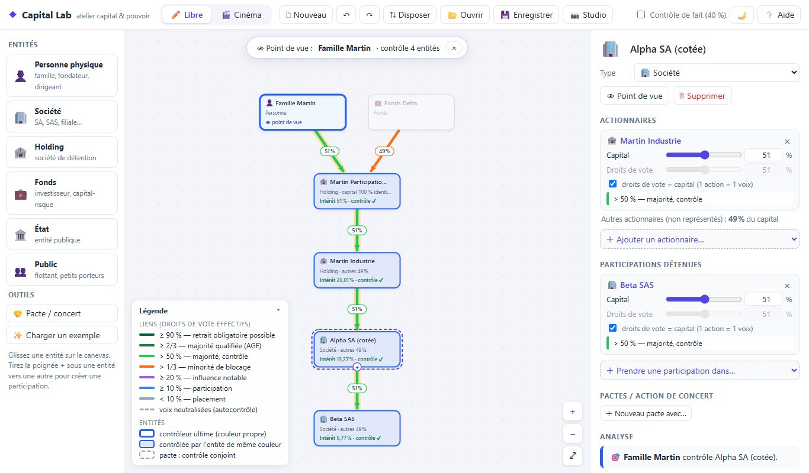

# Getting started (free mode)

Free mode ✏️ is used to build a structure, vary the percentages and watch the effect on control.

## The screen

- **on the left**, the palette: the entity types and the tools;
- **in the centre**, the canvas;
- **on the right**, the inspector: properties and analysis of the selected item, or an overview if nothing is selected.

Free mode: palette on the left, structure in the centre, sliders and analysis of the selected company on the right (French interface).

The 🌙 / ☀️ button at the top right switches between **day** and **night** themes. By default, the workshop follows the system setting; once chosen, the theme is remembered by the browser.

## Choosing the law

The **law** selector in the toolbar offers **United Kingdom** and **United States**. It changes the thresholds, the colours of the links, the legend and the legal references of the analysis; control is computed in the same way under both laws. See [Calculation rules](regles-de-calcul.md).

## Building a structure

1. **Add an entity**: drag a type from the palette (individual, company, holding company, fund, state, public / free float) onto the canvas, or click it to add it in the centre. Rename it in the inspector.
2. **Create a holding**: hover over the shareholder, then pull the **+** handle below it onto the company held. Drop it on the entity itself to represent **treasury shares**.
3. **Set the percentages**: select the link, or the company held. Two sliders set the **shares** (capital) and the **voting rights**. Untick "voting rights = shares" to separate them (dual-class shares, non-voting preference shares).
4. **Add a pact**: 🤝 "Pact / concert" button, then tick the members. Their votes are added together.

In a company's inspector, you can also add a shareholder or a holding with the "＋ Add…" lists.

## Reading the analysis

When you select a company, you see:
- **who controls it**, alone or jointly;
- the **chain of control** (e.g. Family → Holding company → Subsidiary);
- the **voting rights controlled** and the controller's **economic interest**, with a box when control is exercised with less than 50% of the capital;
- the **voting blocks** grouped by ultimate controller and any **blocking minority** (above 25% in the UK; in the US, only if the charter requires a supermajority);
- the votes neutralised as **treasury shares** or shares held by a controlled company;
- inconsistencies: shares or votes allocated beyond 100%.

When you select a shareholder, you see what it controls and its non-controlling interests.

## Point of view 👁

Choose a shareholder ("Point of view" button or the overview list): each entity then shows **its economic interest** and **its voting rights / its control** from that shareholder's point of view. Entities that do not concern it are faded.

Point of view of the parent company (night theme): interest and control in each entity. The dotted frame groups the members of a pact, who together control the joint venture. The partner, which does not concern the parent company, is faded.

## The "De facto control (40%)" option

This option implements a presumption of French law (art. L233-3, II of the French Commercial Code). It is **only available under French law** and does not appear with the UK or US law.

## Shortcuts

| Action | Gesture or key |
|---|---|
| Zoom | mouse wheel, or + / − buttons |
| Pan the view | drag the background |
| Fit everything | **F**, or ⤢ button |
| Delete the selection | **Delete** |
| Undo / redo | **Ctrl+Z** / **Ctrl+Y** |
| Deselect | **Esc** |

## Save, open, rearrange

- **💾 Save** downloads the structure as a `.json` file; **📂 Open** loads it again (or opens a `.md` scenario). A file can also be dropped onto the window.
- Work in progress is saved automatically in the browser.
- **⇅ Arrange** lays out the entities automatically: shareholders above the companies they hold.
- **✨ Load an example** loads the holding pyramid.

## The studio 📸: turning a construction into a scenario

The studio lets you prepare a scenario with the mouse:
1. click **📸 Studio**;
2. build the first step, then **📸 Capture the step**: give a title and a commentary (in markdown). If an entity is selected, it can be highlighted;
3. change the structure, capture the next step, and so on;
4. **▶ Preview** plays it in cinema mode; **⬇ Export .md** produces the scenario file.

The export automatically computes the commands that take the structure from one step to the next. Add the `droit: uk` or `droit: us` header at the top of the exported file if the scenario must always be played under that law.
