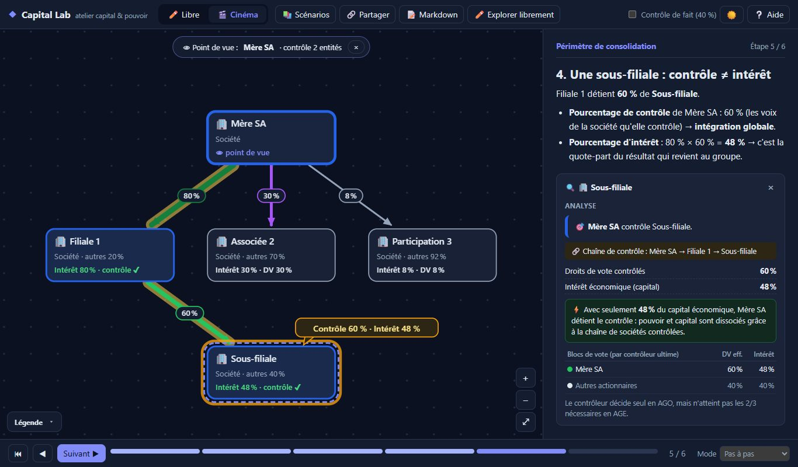

# Calculation rules

This page describes what the engine (`js/model.js`) computes and what it does not represent. It is also the reference for AIs that write scenarios: the commentary of a scenario must state the same results as the tool.

The **calculation of control and interest is the same under every law**. The law (`uk` or `us`, chosen in the toolbar or by the scenario's `droit:` header) only changes the **thresholds, colours, legend and legal references** described in the last sections.

## Entities and holdings

| Type | Command | Can be held? | Can control? |
|---|---|---|---|
| Individual | `person` | no | yes |
| Company | `company` (or `corporation`) | yes | yes |
| Holding company | `holding` | yes | yes |
| Fund | `fund` | yes | yes |
| State / public body | `state` | no | yes |
| Public / free float | `public` | no | **no**: it votes, but dispersed shareholders never form a block |

A holding (link `A -> B`) carries two percentages: the **shares** (capital) and the **voting rights** (equal by default). Whatever is not allocated to anyone is shown as "other shareholders". These others vote (they count in the 100%), but never control.

## Effective voting rights, treasury shares and cross-holdings

The votes attached to shares held by the company **itself** (treasury shares, link `A -> A`) or by a company **that it controls** are **neutralised**. The other shareholders' percentages are then recalculated on the remaining base:

> effective votes = votes held ÷ (100% − neutralised votes)

Example: 46% of the votes, 10% held by a controlled subsidiary and 5% of treasury shares give 46 ÷ 85 = 54.1% of the effective votes. As neutralisation depends on control, and vice versa, the engine iterates until the result is stable.

| Law | Basis |
|---|---|
| UK | the company cannot exercise any right, including voting, in respect of treasury shares (Companies Act 2006, s. 726); a subsidiary cannot be a member of its holding company (s. 136) |
| US | shares of a corporation's own stock belonging to it, or to another corporation of which it holds a majority of the voting shares, are neither voted nor counted for quorum (DGCL §160(c)) |

> ⚠️ In the UK, s. 136 *prohibits* a subsidiary from holding shares in its parent (with limited exceptions) rather than merely suspending the votes. The tool shows what would happen to the votes; the commentary should state that the holding itself is in principle not allowed.

## Control

A **block** is either a single entity or a **pact** (command `concert`) bringing several entities together.

1. **Majority**: a block controls a company if it has **more than 50%** of the effective votes, adding its own votes to those of the companies it already controls. This is **chained** control: the family that controls H1, which controls H2, also controls whatever H2 controls.
2. **Ultimate controller**: the block that controls a company without itself being controlled. If only a pact brings the majority together, control is said to be **joint**.

Exactly 50% does **not** give control: 50/50 means that no shareholder controls alone (deadlock).

| Law | Notion of control used by the tool |
|---|---|
| UK | **subsidiary** (Companies Act 2006, s. 1159): a company of which another holds a majority of the voting rights; a subsidiary of a subsidiary is itself a subsidiary of the parent. For accounts, see *parent undertaking* (s. 1162) |
| US | **majority of the voting power**: the holder elects the board and carries the stockholder votes that require a majority |

**No de facto control presumption.** The French option "de facto control (40%)" is a presumption of French law (art. L233-3, II of the French Commercial Code). It is not available under UK or US law, and the command `regle 40 on` must never appear in a `droit: uk` or `droit: us` scenario. A shareholder with 40% of a widely held company may well control it in practice (and IFRS 10 may treat it as control): this is a matter for the commentary, not for the engine.

**Pact and sole majority holder.** If one member of a pact already holds more than 50% on its own, it is the controller (**sole** control); the pact makes no difference in the tool. Control is shown as **joint** only when no member has the majority alone and the pact brings it together. A veto right or a unanimity requirement in the shareholders' agreement is not modelled: the commentary must explain it.

**Persons acting in concert.** The `concert` command treats the members as a single voting block. This matches the idea of:

| Law | Notion |
|---|---|
| UK | **persons acting in concert** (Takeover Code, Definitions): their holdings are aggregated, notably for the 30% threshold of Rule 9 |
| US | a **group** under Exchange Act §13(d)(3): persons who act together to acquire, hold or dispose of shares (and, under SEC rules, to vote them) are treated as one person, notably for the 5% disclosure threshold |

**Direct holding or control.** The colour of a link concerns only the **direct** holding (the effective votes carried by that link). Thresholds that the law applies to direct *and* indirect holdings, or to holdings aggregated with those of other persons, must be explained in the commentary; the analysis panel gives the total votes controlled.

## Economic interest

A shareholder's interest in a company is the sum, over all holding paths, of the product of the **capital** percentages:

> 51% × 51% × 51% ≈ 13.27%

Control ≠ interest (night theme, French interface): the parent company controls the sub-subsidiary through the chain with 60% of the votes, but its economic interest is only 48% (80% × 60%).

Cross-holdings are taken into account (iterative calculation). Treasury shares are removed from the base.

## Thresholds and link colours

Link colours apply to the **effective voting rights** of the link. The categories are evaluated from the highest to the lowest: the first one reached applies. The legend of the workshop shows the colours for the selected law, from dark green (highest category) to grey (portfolio investment).

Dotted grey links: neutralised votes (treasury shares, shares held by a controlled company).

A **tinted** entity is controlled by the ultimate controller of the same colour. An ultimate controller has a **thick border** in its colour.

### United Kingdom (`droit: uk`)

| Threshold | Category | Meaning |
|---|---|---|
| 90% or more | squeeze-out | after a takeover offer, the bidder can buy out the minority (CA 2006, s. 979) |
| 75% or more | special resolution | passes **special resolutions** alone (s. 283): amending the articles (s. 21), disapplying pre-emption rights, reducing capital… |
| more than 50% | majority | passes **ordinary resolutions** (s. 282), appoints and removes directors; **control**: the company is a subsidiary (s. 1159) |
| 30% or more | mandatory bid | Takeover Code, Rule 9: acquiring an interest in shares carrying 30% or more of the voting rights of a company subject to the Code triggers a **mandatory offer**; above 25%, the holder also blocks special resolutions |
| more than 25% | blocking minority | can defeat any special resolution (75% needed); also a **person with significant control** (PSC register) |
| 20% or more | significant influence | presumed significant influence (IAS 28 / FRS 102): in group accounts the company is normally an **associate**, equity-accounted |
| 3% or more | notifiable | listed companies: holdings of 3% or more of the voting rights must be disclosed (DTR 5) |
| less than 3% | investment | portfolio investment |

> ⚠️ Simplifications. Ordinary and special resolutions are passed by a majority of, or 75% of, the votes **cast** (or of the total voting rights for a written resolution of a private company): with low turnout, a smaller holding may be enough. The 90% of s. 979 is calculated on the shares **to which the offer relates** (those the bidder did not already hold), not on the total. The 3% DTR 5 threshold applies to UK issuers (5% for non-UK issuers). A person can be a PSC on other grounds (right to appoint or remove a majority of the board, significant influence or control).

### United States (`droit: us`, listed Delaware corporation)

| Threshold | Category | Meaning |
|---|---|---|
| 90% or more | short-form merger | a parent holding at least 90% of each class can merge the subsidiary without a stockholder vote (DGCL §253) |
| more than 50% | majority | majority of the voting power: elects the board (no cumulative voting by default), approves charter amendments and mergers (DGCL §242, §251: majority of the outstanding stock); **control** |
| 20% or more | significant influence | presumed significant influence (ASC 323): the investor normally uses the **equity method**; from 15% the holder is also an interested stockholder |
| 15% or more | interested stockholder | DGCL §203: business combinations with the corporation are restricted for 3 years unless approved by the board |
| 10% or more | insider | 10% beneficial owner: Section 16 insider (reporting, short-swing profits) |
| more than 5% | beneficial owner | more than 5% of a registered class: Schedule 13D / 13G disclosure (Exchange Act §13(d)) |
| 5% or less | investment | portfolio investment |

There is **no statutory blocking minority** in Delaware: a supermajority exists only if the **certificate of incorporation (charter) or bylaws** require it. The analysis therefore shows no blocking minority under US law.

> ⚠️ Simplifications. §203 has exceptions (prior board approval, 85% owned when becoming an interested stockholder, opt-out in the charter…). §253 requires 90% of **each class** of stock entitled to vote, and the tool reasons on total voting rights. Beneficial ownership under §13(d) and Section 16 includes shares one has the right to acquire within 60 days and shares held through others: the tool counts only the links drawn. Class votes required by the charter or by DGCL §242(b)(2) are not modelled.

### France

The French interface uses the thresholds of the French Commercial Code (1/3, 50%, 2/3, 90%…): see the [French documentation](../regles-de-calcul.md).

## What the tool does not represent

- debts, loans and financial flows (dividends, interest): put them in the commentary and the bubbles;
- values: goodwill, fair value, price, gain on disposal;
- the qualitative criteria of control (IFRS 10: power, variable returns, link between the two; ASC 810: variable interest entities), potential voting rights, structured entities, control by contract;
- the unanimity required by a joint arrangement (IFRS 11): a pact is treated only as a voting block;
- rights to appoint or remove directors, board-level control, staggered boards, poison pills;
- votes cast versus votes outstanding, quorum, class votes, supermajorities set by the articles, the charter or the bylaws;
- whether a company is subject to the Takeover Code, or has a class of securities registered under the Exchange Act.

In these cases, the canvas shows the structure, and the commentary carries the analysis.
