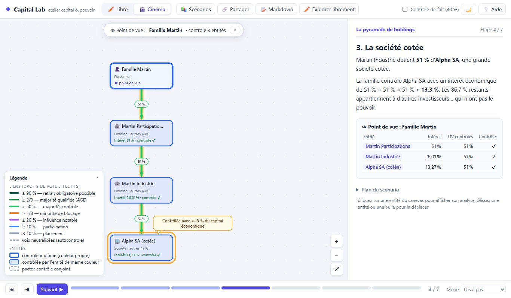

# Capital Lab — taller de capital y poder

> 🌐 Esta es la documentación en español, que aplica el **derecho español**. Versión francesa: [Français](../README.md) · versión inglesa: [English](../en/README.md).

**Capital Lab** es una herramienta didáctica para visualizar las estructuras de participaciones entre sociedades y entender **quién controla qué, a través de qué cadena y con qué parte real del capital**.

Muestra, en particular, cómo se puede ser **minoritario en el capital** y, aun así, **controlar** una sociedad: pirámides de sociedades holding, pactos parasociales, acciones de lealtad con voto doble, autocartera, actuación concertada…

[▶ Abrir el taller](https://edu-fpar.github.io/capital-lab/?lang=es ':ignore') — en línea: **https://edu-fpar.github.io/capital-lab/?lang=es**, también desde el móvil.

El modo libre (noche, captura de la interfaz francesa): una empresa conjunta sometida a un pacto, el punto de vista de la matriz sobre cada entidad y, a la derecha, los controles deslizantes y el análisis de la filial seleccionada.

## 🤖 Preparar la clase con una IA

<ol class="ai-steps">
<li><strong>Copie la consigna.</strong> Ya contiene el enlace a las instrucciones para la IA. El texto se puede modificar: adapte el público o el número de pasos antes de copiarlo.

Lee las instrucciones en https://edu-fpar.github.io/capital-lab/docs/es/instructions-ia.md y prepara un escenario de Capital Lab (derecho español) a partir del curso siguiente (o del archivo adjunto). Público: 3.º del Grado en Derecho, unos 6 pasos, con una o dos preguntas para el aula.

<button class="ai-btn big" data-copy-sel=".js-ia-prompt">📋 Copiar la consigna</button></li>
<li><strong>Péguela en su IA</strong> (ChatGPT, Claude, Gemini, Mistral, Copilot…) y añada su curso: texto pegado a continuación o archivo adjunto.</li>
<li><strong>Copie la respuesta de la IA</strong> y péguela en el <a href="https://edu-fpar.github.io/capital-lab/?lang=es&scenarios" target="_blank" rel="noopener">taller</a>: 🎬 Cine → 📚 Escenarios → Iniciar. Puede pegar la respuesta completa.</li>
</ol>

¿Su IA no puede abrir enlaces?

Copie en su lugar la versión completa: las instrucciones y la consigna reunidas en un solo texto. Péguela en su IA y añada su curso.

<button class="ai-btn warn" data-copy-full="es/instructions-ia.md">📄 Copiar la versión completa</button> <a class="ai-link" href="es/instructions-ia.md" target="_blank" rel="noopener">ver las instrucciones</a>

💡 ¿Usa Claude? La <a href="#/es/ia-et-skill">skill de Capital Lab</a> comprueba además cada cifra con el motor del taller.

ℹ️ Está consultando esta documentación en local: la consigna apunta a la versión publicada, que una IA en línea puede leer.

## Dos formas de usar el taller

| | Modo libre ✏️ | Modo cine 🎬 |
|---|---|---|
| Para quién | el docente que prepara la clase, el alumno que experimenta | la clase, durante la sesión; el alumno que repasa en el móvil |
| Principio | se construye la estructura con el ratón y se ajustan los porcentajes con controles deslizantes | un escenario en markdown desarrolla la construcción paso a paso, con un comentario y preguntas para el aula |
| Ritmo | libre | paso a paso, o reproducción continua a velocidad ajustable |

Los dos modos comparten el mismo motor de cálculo: control en cadena, interés económico, umbrales, autocartera, pactos.

El modo cine (día, captura de la interfaz francesa): la pirámide de sociedades holding, paso 3. El comentario está a la derecha; cada entidad muestra el interés y el control de la familia.

## El derecho aplicado

La interfaz en español aplica el **derecho español**: Ley de Sociedades de Capital, con la sociedad anónima como referencia y remisiones a la sociedad limitada. Los umbrales de la leyenda (mayoría, 2/3, minoría de bloqueo, OPA del 30 %, derechos de minoría del 5 %, venta forzosa del 90 %) y las referencias legales del análisis son las españolas: véase [Reglas de cálculo](regles-de-calcul.md). La presunción francesa de control de hecho con más del 40 % no se aplica.

Un escenario indica su derecho con un encabezado al principio del archivo (`droit: es`): véase el [formato de los escenarios](format-scenario.md).

## ¿Por dónde empezar?

- **Descubrir**: abra el taller, pase al modo 🎬 Cine e inicie «La pirámide de sociedades holding».
- **Presentar en clase**: [Modo cine](mode-cinema.md), [escenarios disponibles](scenarios.md) y [enlaces para compartir](mode-cinema.md#compartir-un-enlace).
- **Construir su propia estructura**: [Primeros pasos en el modo libre](prise-en-main.md).
- **Escribir un escenario**: con una IA (arriba, o con la [skill](ia-et-skill.md)), o a mano con el [formato de los escenarios](format-scenario.md).
- **Entender un resultado sorprendente**: [Reglas de cálculo](regles-de-calcul.md).

## Instalación

Ninguna. El taller es un conjunto de archivos HTML, CSS y JavaScript sin dependencias:
- en línea en **https://edu-fpar.github.io/capital-lab/** (añada `?lang=es` para forzar el español);
- servido por un servidor web local (UwAmp, por ejemplo: `http://localhost/edu-fpar/capital-lab/`);
- o abierto directamente con doble clic en `index.html`.

El botón 🌙 / ☀️ de arriba a la derecha alterna entre el modo día y el modo noche, aquí y en el taller.

Esta documentación necesita un servidor web y conexión a internet (utiliza [Docsify](https://docsify.js.org)). Sin ellos, sus páginas siguen siendo legibles tal cual: son los archivos `.md` de la carpeta `docs/es/`.

## Agradecimientos

Gracias a **Tao**, cuya herramienta, ideada para mostrar a su clase de derecho financiero cómo se puede controlar una sociedad siendo minoritario en ella, está en el origen de este proyecto, y a **Yannick**, que nos transmitió la idea.
