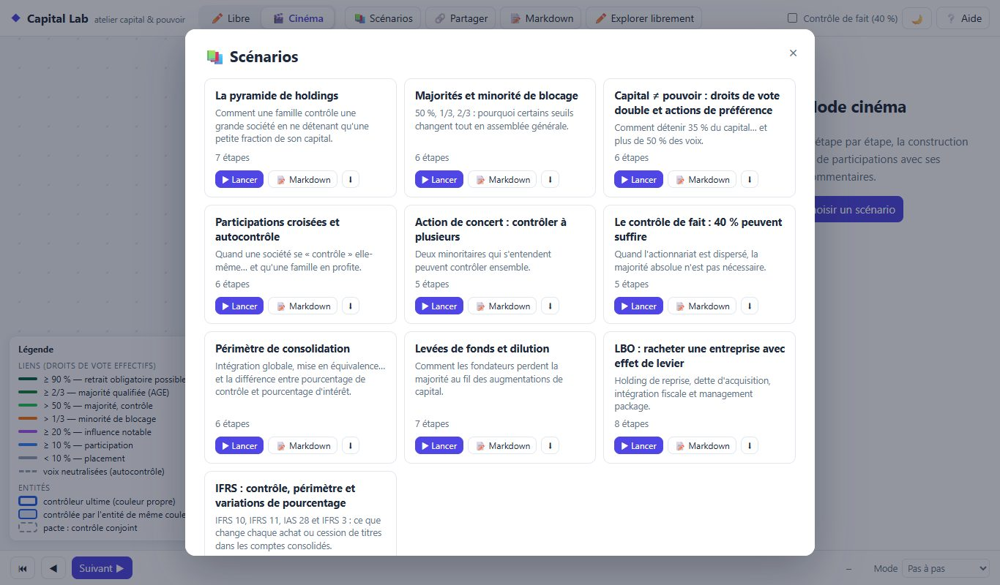
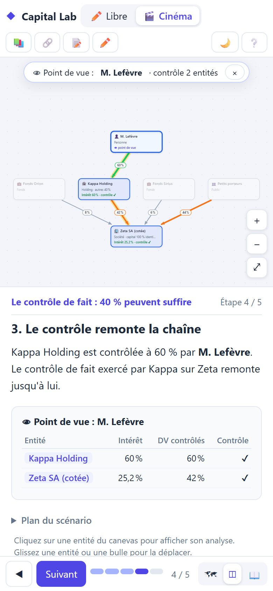
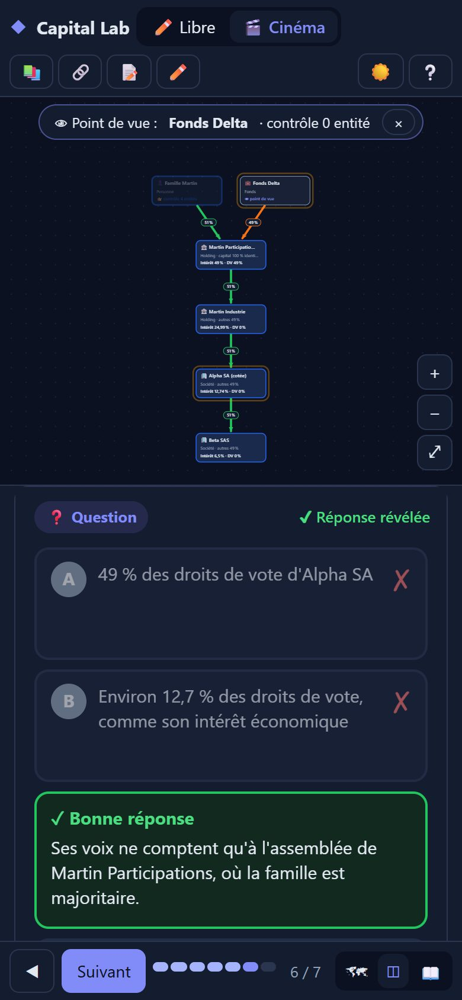
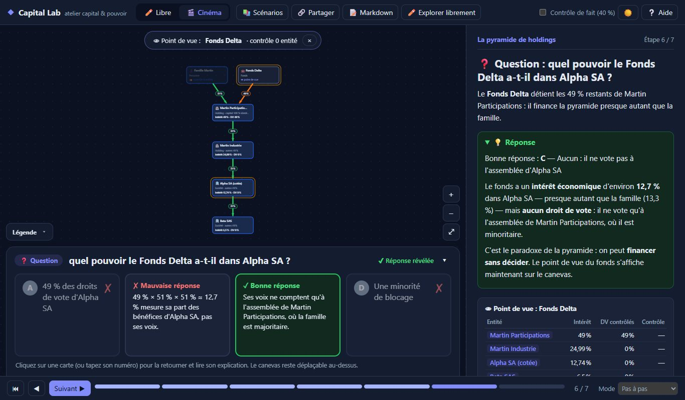

# Modo cine

El modo cine 🎬 desarrolla un **escenario**: en cada paso, el lienzo se anima (entidades que aparecen, vínculos que se trazan, bocadillos y elementos resaltados) y el panel derecho muestra el comentario.

> Las capturas de esta página proceden de la interfaz francesa; en español, los botones y los escenarios llevan textos en español.

## Cargar un escenario

Botón **📚 Escenarios**:
- elegir un escenario de la biblioteca ([lista](scenarios.md));
- o **pegar** el markdown que le haya pasado un colega o una IA y pulsar «▶ Iniciar»;
- o **abrir un archivo** `.md`. También se puede soltar directamente sobre la ventana.

La biblioteca: los escenarios integrados y, debajo, la zona para pegar su propio escenario.

Si el escenario empieza por el encabezado `droit: es`, se analiza con el derecho español, sea cual sea el derecho seleccionado en la barra de herramientas.

## Compartir un enlace

El taller está en línea en **https://edu-fpar.github.io/capital-lab/**. El botón **🔗 Compartir** propone tres enlaces para copiar: al **paso mostrado**, al **inicio del escenario** o a la **biblioteca**. Durante la reproducción, además, la dirección del navegador sigue el paso en curso: también se puede copiar directamente.

| Enlace | Abre |
|---|---|
| `…/capital-lab/?lang=es&scenarios` | la biblioteca de escenarios, en español |
| `…/capital-lab/?lang=es&scenario=es-piramide` | un escenario integrado, en su primer paso |
| `…/capital-lab/?lang=es&scenario=es-piramide&etape=6` | ese escenario, directamente en el paso 6 (también vale `&step=6`) |
| `…/capital-lab/?md=direccion-del-archivo.md` | un escenario publicado como archivo |
| `…/capital-lab/#md=…` | un escenario personal (pegado o generado por una IA), cuyo texto va codificado en el enlace |

El parámetro `lang=es` fuerza la interfaz en español; sin él, el taller usa el idioma elegido la última vez o, en su defecto, el del navegador.

En un escenario personal, el enlace contiene el texto comprimido del escenario después de `#`: no se envía a ningún servidor y funciona sin publicar nada. Con un escenario muy largo, el enlace puede resultar demasiado largo para algunas aplicaciones de mensajería: es mejor publicar el archivo `.md` y usar `?md=`. En todos los casos, `&etape=N` elige el paso de llegada.

## Exportar en SCORM (Moodle)

El botón **📦 SCORM** genera un paquete `.zip` para subir a Moodle (actividad «Paquete SCORM») o a cualquier plataforma compatible con SCORM. El paquete contiene el taller y el escenario mostrado, incluido un escenario personal o modificado: los alumnos lo siguen solos, paso a paso, sin conexión al sitio.

- **Versión**: SCORM 1.2 (recomendada para Moodle) o SCORM 2004 4.ª edición.
- **Finalización**: la actividad se da por «terminada» cuando el alumno llega al último paso.
- **Reanudación**: al volver, el alumno retoma el paso en el que se quedó.
- **Calificación** (opcional, si el escenario tiene preguntas con opciones): sobre 100, la proporción de preguntas en las que el alumno hizo clic en una tarjeta correcta *antes* de revelar la respuesta. Solo cuenta el primer intento.

En el paquete solo queda visible el reproductor: ni modo libre, ni biblioteca, ni opción de compartir. El paquete se construye a partir de los archivos del taller: si el taller se ha abierto con doble clic, los descarga del sitio en línea.

## En el móvil

El taller se adapta a las pantallas estrechas. En el móvil se abre directamente en la biblioteca de escenarios:

- el **esquema** ocupa la parte superior de la pantalla y las **explicaciones** la inferior;
- los botones **🗺 / ◫ / 📖** de la barra inferior muestran solo el esquema, ambos, o solo el texto;
- se **desliza** el texto hacia la izquierda o la derecha para cambiar de paso; los botones **◀ / Siguiente** siguen disponibles;
- se **pellizca** el esquema para hacer zoom, se arrastra para desplazarse y se toca una entidad para mostrar su análisis bajo el texto;
- las **preguntas** aparecen en el texto, con las opciones apiladas: tocar una opción para indicar la respuesta, «Revelar la respuesta» y luego tocar una tarjeta para darle la vuelta.

<figure><figcaption>Esquema y explicaciones</figcaption></figure><figure><figcaption>Una pregunta, en modo noche</figcaption></figure>

El modo libre sigue disponible, pero está pensado para una pantalla más ancha.

## Paso a paso o reproducción continua

En la parte inferior de la pantalla:

| Control | Efecto |
|---|---|
| ⏮ ◀ | volver al inicio, o al paso anterior |
| Siguiente ▶ | paso siguiente |
| barras de progreso | hacer clic en una barra para ir a ese paso |
| Modo **Paso a paso** | es el usuario quien avanza |
| Modo **Reproducción continua** | los pasos se encadenan; ▶ / ⏸ para iniciar o pausar |
| Ritmo | de 0,25× a 3× |

En reproducción continua, la duración de un paso depende de la longitud de su comentario (entre 5 y 45 segundos a velocidad 1×), salvo que el escenario la fije con `duracion`. Una fina barra naranja muestra el tiempo restante.

Teclado: **→** / **←** para avanzar o retroceder, **Espacio** para avanzar (paso a paso) o reproducir/pausar (continuo), **Inicio** / **Fin** para el primer y el último paso, **F** para reencuadrar.

## Pasos con pregunta

Algunos pasos interrogan al público. Su título va precedido de ❓, y una ventana sube por la parte inferior del lienzo con la pregunta y las opciones en grandes tarjetas (A, B, C…).

Una pregunta tras revelar la respuesta (modo noche): la respuesta correcta en verde, dos tarjetas giradas que muestran su explicación, la respuesta detallada a la derecha y el punto de vista del fondo en el lienzo.

1. **Dejar que el aula responda**: a mano alzada, oralmente… Haga clic en la tarjeta elegida por la mayoría, o pulse su número: queda marcada como «👥 elección del aula».
2. **Revelar la respuesta**: botón «💡 Revelar la respuesta», tecla **→**, o botón «💡 Respuesta ▶» de la barra inferior. Un mando de presentación funciona, por tanto: una primera pulsación revela, la siguiente pasa al paso siguiente.
3. **Comentar cada opción**: las respuestas correctas se ponen en verde y las demás se atenúan. Haga clic en una tarjeta, o pulse su número, para **darle la vuelta** y leer por qué esa opción es correcta o incorrecta.
4. **La explicación general** se abre en el panel derecho, en acordeón. La respuesta también puede modificar el lienzo: punto de vista, elemento resaltado, bocadillo.

La ventana no tapa la estructura: el lienzo se reencuadra automáticamente por encima de ella, se puede seguir desplazando y ampliando, y el botón **▾** reduce la ventana a una simple barra. En reproducción continua, el avance se detiene en una pregunta hasta que se revela la respuesta y luego continúa.

Para escribir una pregunta, véase el [formato de los escenarios](format-scenario.md#pasos-con-pregunta).

## Interactuar durante la presentación

- **Hacer clic en una entidad** muestra su análisis completo bajo el comentario.
- **Pasar el ratón por un nombre** resaltado en el comentario destaca la entidad correspondiente; al hacer clic, se selecciona.
- **Mover una entidad o un bocadillo**: arrástrelo. Es útil cuando los bocadillos se solapan o tapan un vínculo. Los desplazamientos se conservan de un paso a otro. El botón **↺ Disposición** devuelve todo a la posición prevista por el escenario. Estos desplazamientos no modifican el escenario.
- El panel «Plan del escenario» permite saltar a cualquier paso.

## Modificar o reutilizar

- **📝 Markdown** abre el texto del escenario: se puede corregir y aplicar sin salir del paso actual, copiar o descargar.
- **✏️ Explorar libremente** copia el estado mostrado al modo libre para manipularlo (cambiar un porcentaje, añadir un accionista…).

Si un escenario contiene comandos que no se entienden, aparece un aviso bajo el comentario, con el número de línea.
