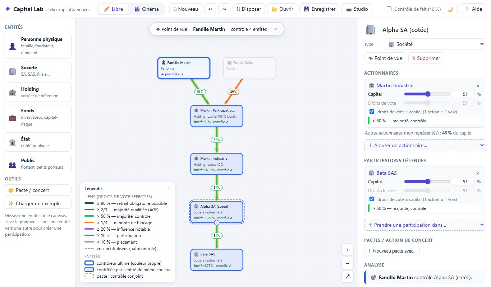

# Primeros pasos (modo libre)

El modo libre ✏️ sirve para construir una estructura, variar los porcentajes y observar el efecto sobre el control.

> Las capturas de esta página proceden de la interfaz francesa.

## La pantalla

- **a la izquierda**, la paleta: los tipos de entidades y las herramientas;
- **en el centro**, el lienzo;
- **a la derecha**, el inspector: propiedades y análisis del elemento seleccionado, o vista general si no hay nada seleccionado.

El modo libre: la paleta a la izquierda, la estructura en el centro, los controles deslizantes y el análisis de la sociedad seleccionada a la derecha.

El botón 🌙 / ☀️ de arriba a la derecha alterna entre el **modo día** y el **modo noche**. Por defecto, el taller sigue la configuración del sistema; una vez elegido, el modo se guarda en el navegador.

## Idioma y derecho

La interfaz en español aplica el **derecho español** (Ley de Sociedades de Capital, SA de referencia). El selector de la barra de herramientas permite cambiar de idioma y de derecho: el derecho elegido determina los umbrales, los colores y los textos de la leyenda y del análisis, así como las referencias legales. Véase [Reglas de cálculo](regles-de-calcul.md).

## Construir una estructura

1. **Añadir una entidad**: arrastre un tipo desde la paleta (persona física, sociedad, holding, fondo, Estado, público) al lienzo, o haga clic en él para añadirlo en el centro. Cámbiele el nombre en el inspector.
2. **Crear una participación**: pase el ratón por encima del accionista y tire del asa **+** situada debajo de él hasta la sociedad participada. Arrástrela sobre la propia entidad para representar **autocartera**.
3. **Ajustar los porcentajes**: seleccione el vínculo o la sociedad participada. Dos controles deslizantes ajustan el **capital** y los **derechos de voto**. Desmarque «derechos de voto = capital» para separarlos (acciones de lealtad con voto doble, acciones sin voto).
4. **Añadir un pacto**: botón 🤝 «Pacto / concierto» y marque los miembros. Sus votos se suman.

En el inspector de una sociedad también se puede añadir un accionista o una participación con las listas «＋ Añadir…».

## Leer el análisis

Al seleccionar una sociedad, se ve:
- **quién la controla**, de forma exclusiva o conjunta;
- la **cadena de control** (p. ej., Familia → Holding → Filial);
- los **derechos de voto controlados** y el **interés económico** del controlador, con un recuadro cuando el control se ejerce con menos del 50 % del capital;
- los **bloques de voto** agrupados por controlador último y una posible **minoría de bloqueo**;
- los votos neutralizados por la **autocartera** o por las acciones en poder de filiales;
- las incoherencias: capital o votos atribuidos por encima del 100 %.

Al seleccionar un accionista, se ve lo que controla y sus intereses sin control.

## El punto de vista 👁

Elija un accionista (botón «Punto de vista» o lista de la vista general): cada entidad muestra entonces **su interés económico** y **sus derechos de voto / su control** desde el punto de vista de ese accionista. Las entidades que no le afectan se atenúan.

Punto de vista de la matriz (Mère SA, modo noche): interés y control sobre cada entidad. El marco punteado agrupa a los miembros de un pacto, que controlan juntos JV Co. El socio externo, que no afecta a la matriz, aparece atenuado.

## Sin «control de hecho (40 %)»

La interfaz francesa ofrece una opción que activa la presunción de control del Código de Comercio francés (más del 40 % de los votos, sin otro socio por encima). Esa presunción no existe en derecho español: con el derecho español seleccionado, el control solo se obtiene con más del 50 % de los votos efectivos, solo o mediante un pacto. Véase [Reglas de cálculo](regles-de-calcul.md#control).

## Atajos

| Acción | Gesto o tecla |
|---|---|
| Ampliar / reducir | rueda del ratón, o botones + / − |
| Desplazar la vista | arrastrar el fondo |
| Ver todo | **F**, o botón ⤢ |
| Eliminar la selección | **Supr** |
| Deshacer / rehacer | **Ctrl+Z** / **Ctrl+Y** |
| Deseleccionar | **Esc** |

## Guardar, abrir, reorganizar

- **💾 Guardar** descarga la estructura en formato `.json`; **📂 Abrir** la vuelve a cargar (o abre un escenario `.md`). También se puede soltar un archivo sobre la ventana.
- El trabajo en curso se conserva automáticamente en el navegador.
- **⇅ Disponer** ordena automáticamente las entidades: los accionistas encima de las sociedades que poseen.
- **✨ Cargar un ejemplo** carga la pirámide de sociedades holding.

## El estudio 📸: convertir una construcción en escenario

El estudio permite preparar un escenario con el ratón:
1. haga clic en **📸 Estudio**;
2. construya el primer paso y pulse **📸 Capturar el paso**: dele un título y un comentario (en markdown). Si hay una entidad seleccionada, puede resaltarse;
3. modifique la estructura, capture el paso siguiente, y así sucesivamente;
4. **▶ Previsualizar** lo reproduce en modo cine; **⬇ Exportar .md** genera el archivo del escenario.

La exportación calcula automáticamente los comandos que llevan de un paso al siguiente. Compruebe que el archivo exportado empieza por el encabezado `droit: es` si quiere que se analice siempre con el derecho español (véase el [formato](format-scenario.md)).
