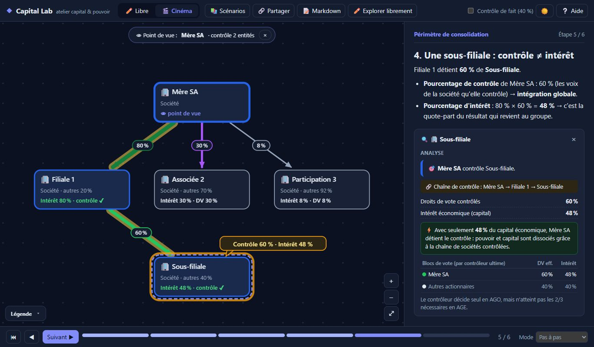

# Reglas de cálculo

Esta página describe lo que calcula el motor (`js/model.js`) y lo que no representa. Sirve también de referencia para generar escenarios: el comentario de un escenario debe anunciar los mismos resultados que la herramienta.

Se refiere al **derecho español** (`droit: es`), el que aplica la interfaz en español: Ley de Sociedades de Capital (LSC), con la **sociedad anónima** como referencia y remisiones a la **sociedad limitada**. Las reglas de cálculo del control y del interés son las mismas en todos los derechos; lo que cambia son los umbrales, la leyenda y las referencias legales.

## Entidades y participaciones

| Tipo | Comando | ¿Puede ser poseída? | ¿Puede controlar? |
|---|---|---|---|
| Persona física | `persona` | no | sí |
| Sociedad | `sociedad` (también `empresa`, `filial`) | sí | sí |
| Holding | `holding` | sí | sí |
| Fondo | `fondo` (también `inversor`) | sí | sí |
| Estado / entidad pública | `estado` | no | sí |
| Público / capital flotante | `publico` (también `mercado`, `bolsa`) | no | **no**: vota, pero un accionariado disperso nunca forma un bloque |

Una participación (vínculo `A -> B`) lleva dos porcentajes: el **capital** y los **derechos de voto** (iguales por defecto). Lo que no se atribuye a nadie se muestra como «otros accionistas». Esos otros votan (cuentan en el 100 %), pero nunca controlan.

## Derechos de voto efectivos y autocartera

Los votos de las acciones que posee la **propia** sociedad (autocartera, vínculo `A -> A`) o una sociedad **que ella controla** (acciones de la dominante en poder de sus filiales) quedan **neutralizados**. En derecho español, los derechos de voto de la autocartera están suspendidos (art. 148 LSC), y lo mismo ocurre con las acciones de la sociedad dominante adquiridas por sus filiales (art. 134 y ss. LSC). Los porcentajes de los demás accionistas se recalculan entonces sobre la base restante:

> votos efectivos = votos poseídos ÷ (100 % − votos neutralizados)

Ejemplo: el 46 % de los votos, con un 10 % en poder de una filial y un 5 % de autocartera, da 46 ÷ 85 = 54,1 % de votos efectivos. Como la neutralización depende del control, y viceversa, el motor itera hasta que el resultado se estabiliza.

## Control

Un **bloque** es una entidad sola o un **pacto** (comando `concierto`) que reúne varias entidades.

1. **Mayoría**: un bloque controla una sociedad si dispone de **más del 50 %** de los votos efectivos, sumando sus propios votos y los de las sociedades que ya controla. Es el control **en cadena**: la familia que controla H1, que controla H2, controla también lo que controla H2. Corresponde al primer supuesto del art. 42 del Código de Comercio (poseer la mayoría de los derechos de voto), al que remite la LSC para definir el grupo de sociedades (art. 18 LSC).
2. **Sin presunción del 40 %**: la regla del «control de hecho» con más del 40 % de los votos es una presunción del derecho francés. No existe en derecho español: el comando `regla 40` no debe usarse en un escenario `droit: es`. Los demás supuestos del art. 42 del Código de Comercio (facultad de nombrar o destituir a la mayoría del órgano de administración, mayoría de los votos en virtud de acuerdos con terceros, mayoría del consejo designada con sus votos) no se calculan: los acuerdos con terceros pueden representarse con un `concierto`; lo demás va en el comentario.
3. **Controlador último**: el bloque que controla una sociedad sin estar él mismo controlado. Si solo un pacto reúne la mayoría, el control se considera **conjunto**.

Exactamente el 50 % **no** da el control: 50/50 significa que ningún socio controla solo.

**Pacto y socio mayoritario.** Si uno de los miembros de un pacto dispone ya, por sí solo, de más del 50 %, el controlador es él (control **exclusivo**); el pacto no cambia nada en la herramienta. El control solo aparece como **conjunto** cuando ningún miembro tiene la mayoría por sí solo y el pacto la reúne. Un derecho de veto o una decisión de común acuerdo previstos en un pacto parasocial no se modelizan: corresponde al comentario explicarlos.

**Actuación concertada.** Un `concierto` suma los votos de sus miembros, como hace la normativa de OPA con las personas que actúan concertadamente (RD 1066/2007, art. 5).

**Filial o sociedad controlada.** La herramienta razona en términos de **control**, directo o indirecto. El color de un vínculo solo describe la participación directa: una sociedad controlada en cadena (una «nieta») aparece controlada por la sociedad cabecera aunque esta no posea ninguna acción suya. Si el curso plantea una cuestión de participación directa, la respuesta va en el comentario.

## Interés económico

El interés de un accionista en una sociedad es la suma, sobre todos los caminos de tenencia, del producto de los porcentajes de **capital**:

Control ≠ interés (modo noche, captura de la interfaz francesa): Mère SA controla la sociedad nieta a través de la cadena con el 60 % de los votos, pero solo posee en ella un 48 % de interés económico (80 % × 60 %).

> 51 % × 51 % × 51 % ≈ 13,27 %

Las participaciones cruzadas se tienen en cuenta (cálculo iterativo). Las acciones en autocartera se retiran de la base.

## Umbrales y colores de los vínculos

Las categorías se aplican a los **derechos de voto efectivos** del vínculo. Se evalúan de la más alta a la más baja: se muestra la primera que se alcanza.

| Umbral | Clave | Significado (sociedad anónima de referencia) |
|---|---|---|
| 90 % o más | `venta` | tras una OPA dirigida a la totalidad del capital, **venta forzosa** (*squeeze-out*) de los minoritarios, en las condiciones de la normativa de OPA |
| 2/3 o más | `reforzada` | **mayoría reforzada**: en la SA, si concurre menos del 50 % del capital, modificar los estatutos exige 2/3 del capital presente o representado (art. 201.2 LSC); en la SL, la transformación, la fusión, la escisión o la supresión del derecho de preferencia exigen 2/3 de los votos (art. 199 b LSC) |
| más del 50 % | `mayoria` | **mayoría absoluta**: adopta sola los acuerdos de la junta general; **control** (art. 42 del Código de Comercio) |
| más de 1/3 | `bloqueo` | **minoría de bloqueo** frente a los acuerdos que exigen 2/3 (SL; SA con quórum bajo) |
| 30 % o más | `opa` | sociedad cotizada: alcanzar el 30 % de los derechos de voto obliga a formular una **OPA** (RD 1066/2007, art. 4) |
| 20 % o más | `influencia` | se presume **influencia significativa** (NIC 28): en las cuentas consolidadas, la sociedad se integra por el **método de la participación** |
| 5 % o más | `minoria` | **derechos de minoría**: solicitar la convocatoria de la junta, el complemento del orden del día, ejercer la acción social de responsabilidad (3 % en las cotizadas) |
| menos del 5 % | `inversion` | inversión financiera |

Los colores van del verde oscuro (umbral más alto) al gris (inversión); la leyenda del taller los muestra. Vínculos en gris punteado: votos neutralizados (autocartera, acciones de la dominante en poder de filiales).

Una entidad **teñida** está controlada por el controlador último del mismo color. Un controlador último tiene un **borde grueso** de su color.

> ⚠️ Simplificaciones. La herramienta razona como si todos los votos estuvieran presentes en la junta. En la SA, las mayorías dependen en realidad del capital presente o representado: mayoría simple de los votos para los acuerdos ordinarios, mayoría absoluta o 2/3 para las modificaciones estatutarias según el quórum (art. 201 LSC). Como solo se muestra la categoría más alta, una participación del 40 % aparece como **minoría de bloqueo**, aunque también supere el umbral de OPA del 30 %: el comentario debe recordarlo cuando sea relevante.

## Lo que la herramienta no representa

- las deudas, los préstamos y los flujos financieros (dividendos, intereses): se ponen en los comentarios y los bocadillos;
- los valores: fondo de comercio, valor razonable, precio, resultado de la venta;
- los demás supuestos de control del art. 42 del Código de Comercio (nombramiento de la mayoría del órgano de administración) y los criterios cualitativos del control (NIIF 10: poder, rendimientos variables, vínculo entre ambos), los derechos de voto potenciales, las entidades estructuradas, el control por contrato;
- la unanimidad exigida por un acuerdo conjunto (NIIF 11): un pacto solo se trata como un bloque de voto;
- las reglas propias de cada forma social (estatutos de la SL, quórum de constitución de la SA, mayorías estatutarias reforzadas, condiciones exactas de la venta forzosa).

En esos casos, el lienzo muestra la estructura y el comentario aporta el análisis.
