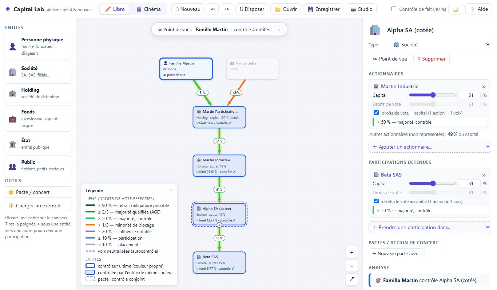

# Prise en main (mode libre)

Le mode libre ✏️ sert à construire une structure, à faire varier les pourcentages et à observer l'effet sur le contrôle.

## L'écran

- **à gauche**, la palette : les types d'entités et les outils ;
- **au centre**, le canevas ;
- **à droite**, l'inspecteur : propriétés et analyse de l'élément sélectionné, ou vue d'ensemble si rien n'est sélectionné.

Le mode libre : palette à gauche, structure au centre, curseurs et analyse de la société sélectionnée à droite.

Le bouton 🌙 / ☀️ en haut à droite bascule entre le **mode jour** et le **mode nuit**. Par défaut, l'atelier suit le réglage du système ; une fois choisi, le mode est mémorisé dans le navigateur.

## Construire une structure

1. **Ajouter une entité** : glissez un type depuis la palette (personne physique, société, holding, fonds, État, public) sur le canevas, ou cliquez dessus pour l'ajouter au centre. Renommez-la dans l'inspecteur.
2. **Créer une participation** : survolez l'actionnaire, puis tirez la poignée **+** située sous lui jusqu'à la société détenue. Tirez-la sur l'entité elle-même pour représenter de l'**auto-détention**.
3. **Régler les pourcentages** : sélectionnez le lien, ou la société détenue. Deux curseurs règlent le **capital** et les **droits de vote**. Décochez « droits de vote = capital » pour les dissocier (droits de vote double, actions de préférence).
4. **Ajouter un pacte** : bouton 🤝 « Pacte / concert », puis cochez les membres. Leurs voix sont additionnées.

Dans l'inspecteur d'une société, on peut aussi ajouter un actionnaire ou une participation avec les listes « ＋ Ajouter… ».

## Lire l'analyse

En sélectionnant une société, on voit :
- **qui la contrôle**, de façon exclusive ou conjointe, de droit ou de fait ;
- la **chaîne de contrôle** (ex. Famille → Holding → Filiale) ;
- les **droits de vote contrôlés** et l'**intérêt économique** du contrôleur, avec un encadré quand le contrôle s'exerce avec moins de 50 % du capital ;
- les **blocs de vote** regroupés par contrôleur ultime et une éventuelle **minorité de blocage** ;
- les voix neutralisées par l'**autocontrôle** ;
- les incohérences : capital ou voix attribués au-delà de 100 %.

En sélectionnant un actionnaire, on voit ce qu'il contrôle et ses intérêts sans contrôle.

## Le point de vue 👁

Choisissez un actionnaire (bouton « Point de vue » ou liste de la vue d'ensemble) : chaque entité affiche alors **son intérêt économique** et **ses droits de vote / son contrôle** du point de vue de cet actionnaire. Les entités qui ne le concernent pas sont estompées.

Point de vue de Mère SA (mode nuit) : intérêt et contrôle sur chaque entité. Le cadre en pointillés regroupe les membres d'un pacte, qui contrôlent ensemble JV Co. Partenaire, qui ne concerne pas Mère SA, est estompé.

## Option « Contrôle de fait (40 %) »

En haut à droite. Active la présomption de contrôle du Code de commerce : plus de 40 % des voix, sans autre associé au-dessus. Voir [Règles de calcul](regles-de-calcul.md).

## Raccourcis

| Action | Geste ou touche |
|---|---|
| Zoomer | molette, ou boutons + / − |
| Déplacer la vue | glisser le fond |
| Tout afficher | **F**, ou bouton ⤢ |
| Supprimer la sélection | **Suppr** |
| Annuler / rétablir | **Ctrl+Z** / **Ctrl+Y** |
| Désélectionner | **Échap** |

## Enregistrer, ouvrir, réorganiser

- **💾 Enregistrer** télécharge la structure au format `.json` ; **📂 Ouvrir** la recharge (ou ouvre un scénario `.md`). Un fichier peut aussi être déposé sur la fenêtre.
- Le travail en cours est conservé automatiquement dans le navigateur.
- **⇅ Disposer** range automatiquement les entités : les actionnaires au-dessus des sociétés qu'ils détiennent.
- **✨ Charger un exemple** charge la pyramide de holdings.

## Le studio 📸 : transformer une construction en scénario

Le studio permet de préparer un scénario à la souris :
1. cliquez sur **📸 Studio** ;
2. construisez la première étape, puis **📸 Capturer l'étape** : donnez un titre et un commentaire (en markdown). Si une entité est sélectionnée, elle peut être mise en évidence ;
3. modifiez la structure, capturez l'étape suivante, et ainsi de suite ;
4. **▶ Prévisualiser** la lit en mode cinéma ; **⬇ Exporter .md** produit le fichier du scénario.

L'export calcule automatiquement les commandes qui font passer d'une étape à la suivante.
